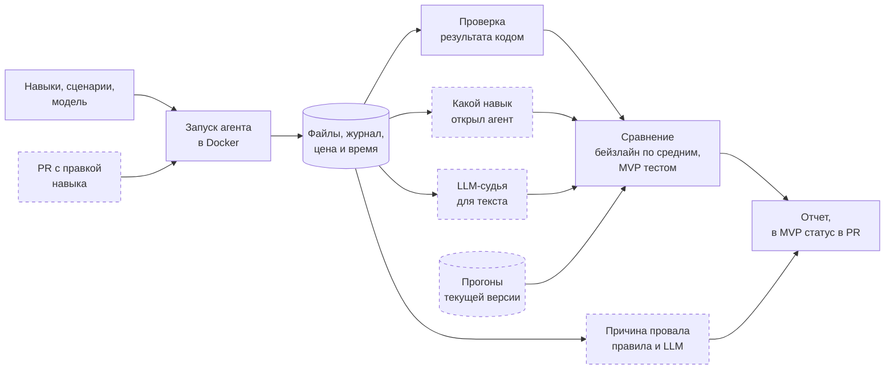

# Стенд для тестирования навыков LLM-агентов

Дизайн-документ по [шаблону Reliable ML](https://github.com/IrinaGoloshchapova/ml_system_design_doc_ru/blob/main/ML_System_Design_Doc_Template.md), разделы 1 и 2. Ярослав Рогоза, курс ML System Design, ИТМО, 2026.

Навык (Agent Skill) это папка с инструкцией `SKILL.md` и скриптами. Агент подключает навык, когда задача подходит под его описание. Сценарий это задача с входными файлами и проверкой результата кодом. Прогон это один запуск агента на сценарии.

## 1. Цели и предпосылки

### 1.1. Зачем идем в разработку продукта?

Агентам вроде Claude Code и Codex дают навыки, чтобы они выполняли рабочие процедуры компании. Например, сверяли две выгрузки или собирали отчет в Excel по внутренним правилам. Навык пишут обычным текстом и проверяют вручную на паре примеров. Этого мало по четырем причинам.

1. Навык может навредить. В бенчмарке SkillsBench навыки от экспертов подняли долю решенных задач с 34 до 51%. Навыки, которые модель написала себе сама, в части конфигураций эту долю снизили [1].
2. Агент может взять не тот навык. Чем больше навыков в библиотеке, тем чаще агент ошибается с выбором [2]. Достаточно расширить описание одного навыка, и он начнет перехватывать чужие задачи.
3. Качество меняется без правок навыка. GPT-4 за три месяца 2023 года упал с 84 до 51% на одной и той же задаче [3]. То же бывает при обновлении модели или агента.
4. Агент на одну задачу отвечает по-разному. По одному запуску нельзя понять, стало хуже или просто не повезло.

#### Бизнес-цель

Принимать навыки и их правки по измеренной пользе и цене. Находить поломки раньше пользователей.

#### Заказчик и текущий процесс

Реального заказчика нет. Моделируем отдел аналитики, который готовит отчеты через Claude Code. У отдела 12 навыков и около 5 правок в неделю. Стендом пользуются автор навыка и тот, кто принимает правки в библиотеку.

| | Сейчас | Со стендом |
|---|---|---|
| Новый навык | Автор пробует пару раз | Видно, на сколько навык поднял долю решенных задач |
| Правка навыка | Ревьюер читает diff | Статус в PR, список сломанных задач и причины |
| Обновление модели | Узнаем от пользователей | Прогон всей библиотеки и список того, что сломалось |

#### Почему нужен ML

Проверка кодом скажет, что файл неверный, но не скажет почему. Причину провала по журналу агента находит LLM. Она же оценивает свободный текст, например выводы в отчете. Статистика отличает поломку от случайного разброса.

#### Успех итерации

Сломанные правки не доходят до пользователей, а рабочие не блокируются. Пороги в разделе 1.2.

### 1.2. Бизнес-требования и ограничения

#### Что должен уметь стенд

1. Запускать агента в изолированном контейнере, каждый раз с одинаковыми файлами.
2. Запускать сценарий без навыков, с одним навыком и со всей библиотекой.
3. Проверять результат кодом и по журналу определять, какой навык открыл агент.
4. Считать цену и время каждого прогона.
5. Сравнивать две версии навыка или модели и говорить, стала ли новая хуже.
6. Называть причину каждого провала.
7. Проверять каждый PR с правкой навыка и ставить статус.
8. Сохранять версии всего, что участвовало в прогоне, чтобы его можно было повторить.

#### Ограничения

- Бюджет на API до 200 $ за семестр.
- Один разработчик, срок до декабря 2026 года.
- Только синтетические данные.
- Агент выполняет код, поэтому работает в контейнере с доступом только к API модели.
- Не больше 8 прогонов параллельно из-за лимитов API.

#### Что ждем от MVP

- 12 навыков. 6 своих, 3 готовых навыка Anthropic для xlsx, pdf и docx и 3 двойника с похожими описаниями, чтобы проверить, путает ли их агент.
- 60 сценариев. 48 требуют какой-то навык, 12 не требуют никакого.
- Стенд на Claude Code с двумя моделями Anthropic, дешевой и средней.
- Проверку PR в GitHub Actions.

#### Как пройдет пилот

1. Автор открывает PR с правкой навыка.
2. Стенд запускает новую версию на 6 сценариях этого навыка и 6 сценариях соседнего, у которого самое похожее описание. Каждый сценарий 3 раза, всего 36 прогонов.
3. Прогоны текущей версии стенд берет из кэша и сравнивает с новыми.
4. Стенд пишет отчет в PR. Если новая версия хуже, PR блокируется. Владелец библиотеки может снять блок.
5. Раз в неделю стенд прогоняет всю библиотеку.

#### Пример

Аналитик расширил описание навыка сверки выгрузок `reconcile-exports`, чтобы тот работал и с CSV из 1С. Сам навык не изменился, но агент стал брать его в задачах соседнего навыка `check-data-quality`. Через полчаса в PR приходит отчет, числа в нем условные.

```text
reconcile-exports, новая версия против текущей, 36 прогонов
Задачи навыка    17 из 18 -> 17 из 18   без изменений
Задачи соседа    16 из 18 ->  7 из 18   хуже, p = 0,001
Причина 9 из 12 провалов: открыт reconcile-exports вместо check-data-quality
```

Аналитик сужает описание и запускает проверку снова.

#### Критерии успеха пилота

| Метрика | Порог | Что дает бизнесу |
|---|---|---|
| Стенд ловит заранее испорченные навыки | 13 из 15 | Сломанные правки не доходят до пользователей |
| Ложные блокировки PR | не больше 5% | Авторы не ждут зря |
| Время проверки PR | до 40 минут | Ревью не тормозит |
| Цена проверки PR | до 5 $ | Проверка укладывается в бюджет |
| Причина провала совпадает с ручной разметкой | от 75% | Журналы не нужно читать вручную |
| Оценки LLM-судьи совпадают с человеком | κ Коэна от 0,7 | Судье можно верить |

Время и цену посчитали из 36 прогонов до 6 минут и около 0,1 $ каждый на 8 контейнерах. Испорченный навык роняет долю успеха на 30 п.п. и больше, такое падение тест замечает, поэтому ждем 13 из 15. κ Коэна это согласие двух оценщиков с поправкой на случайные совпадения, 0,7 считают существенным согласием [4].

### 1.3. Что входит в скоуп проекта/итерации, что не входит

Входит в MVP.

- Claude Code в Docker через [Harbor](https://github.com/harbor-framework/harbor), две модели Anthropic.
- Прогоны без навыков, с одним навыком и со всей библиотекой.
- Проверка результата кодом, выбор навыка, цена и время.
- Сравнение версий статистическим тестом.
- Причины провалов и LLM-судья.
- Отчет в PR через GitHub Actions.

Не входит.

- Другие агенты, например Codex. Добавим после пилота.
- Безопасность навыков. Это уже умеет NVIDIA SkillEvaluator [5].
- Автоматическое улучшение навыков. Это отдельная задача.
- Оформление документов. Проверяем только содержимое.

Код проверяют ruff, mypy, pytest и pre-commit, те же проверки идут в CI. Каждый прогон сохраняет версии сценария, навыка, модели и агента, поэтому его можно повторить.

Технический долг. Один агент и одна машина, файлы вместо базы данных, судья и классификатор на промптах без дообучения.

### 1.4. Предпосылки решения

1. Агент на одну задачу отвечает по-разному, поэтому каждый сценарий запускаем 3 раза. Версии сравниваем на одних и тех же сценариях.
2. В опубликованных прогонах SkillsBench на задачах с документами в 78% случаев все три запуска дали одинаковый исход (`scripts/skillsbench_variance.py`). Значит, трех запусков хватит, чтобы заметить крупные поломки.
3. Результат задачи это файл, например xlsx или pdf. Его можно проверить кодом.
4. В журнале Claude Code видно, какой навык открыл агент и сколько стоил запуск [6].
5. Каждый запуск идет в чистом контейнере, поэтому агент видит только те навыки, которые дали ему мы.
6. Версия модели зафиксирована, поэтому старые прогоны можно переиспользовать.
7. Сценарии подбираем так, чтобы без навыка агент решал от 20 до 60% из них. Иначе пользу навыка не измерить.

## 2. Методология

### 2.1. Постановка задачи

Модель мы не обучаем. Стенд запускает агента, проверяет результат и сравнивает версии статистически. ML внутри это две задачи классификации по журналу агента. Одна находит причину провала, другая оценивает текст.

#### Метрики

| Метрика | Что показывает |
|---|---|
| Доля успешных прогонов | Как часто агент решает задачу |
| Польза навыка | Разница доли успешных прогонов с навыком и без него |
| Точность выбора | Как часто агент открывает нужный навык из библиотеки |
| Ложные срабатывания | Как часто агент открывает навык там, где он не нужен |
| pass^3 | Доля сценариев, решенных во всех трех запусках [7] |
| Цена успеха | Сколько стоит одно успешное решение |

#### Сравнение версий

Новую и текущую версию навыка запускаем на одних сценариях по 3 раза. Стала ли новая хуже, проверяем перестановочным тестом. Он много раз перемешивает метки «новая» и «текущая» внутри каждого сценария и смотрит, как часто случайность дает такое же падение. Задачи навыка и задачи соседа проверяем отдельно, каждые на уровне 2,5%. Тогда ложных блокировок не больше 5%.

На 6 сценариях по 3 запуска тест с вероятностью 80% замечает падение доли успеха от 25 до 47 п.п., в зависимости от разброса. Мелкие ухудшения он пропустит, об этом пишем в каждом отчете. Расчет печатает `uv run python -m skills_testbed.power`.

#### Причины провалов

LLM читает журнал провалившегося прогона и выбирает причину из списка. Агент не открыл нужный навык, открыл чужой, пропустил шаг навыка, ошибка в самом навыке, ошибка агента, сбой инфраструктуры или ошибка в сценарии. Первые два случая и сбои определяем правилами, без LLM. Качество меряем совпадением с ручной разметкой 100 провалов.

#### LLM-судья

Где результат нельзя проверить кодом, например выводы в отчете, LLM-судья отвечает да или нет по критерию. Судья работает на модели другого производителя, потому что модели завышают оценки своим ответам [8]. Его ответы сверяем с разметкой человека на 100 прогонах.

#### Как проверяем сам стенд

Мы сами портим навыки пятью способами. Делаем описание расплывчатым, удаляем шаг, ломаем скрипт, меняем правило, добавляем похожий навык-двойник. На трех навыках это 15 испорченных версий, стенд должен поймать хотя бы 13. Ложные тревоги проверяем A/A-тестом, то есть сравниваем две группы прогонов одной и той же версии.

#### Бейзлайн и MVP

Бейзлайн запускает сценарий один раз и сравнивает доли успеха. Из-за случайности он часто ошибается. Правило «упало больше чем на 5 п.п.» на 12 сценариях дает ложную тревогу примерно в трети случаев.

| | Бейзлайн | MVP |
|---|---|---|
| Запусков на сценарий | 1 | 3 |
| Решение о поломке | Падение больше 5 п.п. | Статистический тест |
| Выбор навыка из библиотеки | Не проверяем | Проверяем |
| Причины провалов | Нет | Правила и LLM |
| Запуск | Вручную | Автоматически в PR |

### 2.2. Блок-схема решения

Пунктиром отмечено то, что MVP добавляет к бейзлайну.



### 2.3. Этапы решения задачи

| Этап | Результат |
|---|---|
| 1. Данные | 6 своих навыков, 3 двойника, 60 сценариев с проверкой кодом |
| 2. Бейзлайн | Первые доли успеха, цена и время прогона |
| 3. Статистика | Сравнение версий, A/A-тест |
| 4. Причины провалов и судья | Классификатор и судья, сверенные с ручной разметкой |
| 5. CI | Проверка PR, прогон 15 испорченных навыков |

Сценарии и входные файлы генерируем сами скриптом с фиксированным seed. Готовые навыки Anthropic ставим при запуске, их лицензия не дает класть их в репозиторий. Задачи SkillsBench не берем, на сильной модели их прогон стоит от 5 до 7 $ [1].

Бюджет пилота около 1700 прогонов по 0,1 $ и 10 $ на вызовы LLM, всего около 180 $. Если прогон окажется дороже, сократим еженедельные прогоны.

## Аналоги

Ближе всего NVIDIA SkillEvaluator [5]. Он сравнивает агента с навыком и без, но по документации не сравнивает две версии навыка между собой и не называет причины провалов. SkillsBench [1] это набор задач, а не инструмент для проверки своей библиотеки.

## Источники

1. [SkillsBench](https://arxiv.org/abs/2602.12670), arXiv 2602.12670, 2026.
2. [Demystifying Agent Skills](https://arxiv.org/abs/2608.14036), arXiv 2608.14036, 2026.
3. Chen, Zaharia, Zou. [How is ChatGPT's behavior changing over time?](https://arxiv.org/abs/2307.09009) arXiv 2307.09009, 2023.
4. Landis, Koch. [The Measurement of Observer Agreement for Categorical Data](https://www.jstor.org/stable/2529310). Biometrics, 1977.
5. [ACES и NVIDIA SkillEvaluator](https://arxiv.org/abs/2608.20614), arXiv 2608.20614, 2026.
6. [Документация Claude Code](https://code.claude.com/docs/en/headless).
7. Yao и др. [τ-bench](https://arxiv.org/abs/2406.12045), arXiv 2406.12045, 2024.
8. Panickssery, Bowman, Feng. [LLM Evaluators Recognize and Favor Their Own Generations](https://arxiv.org/abs/2404.13076), arXiv 2404.13076, 2024.
