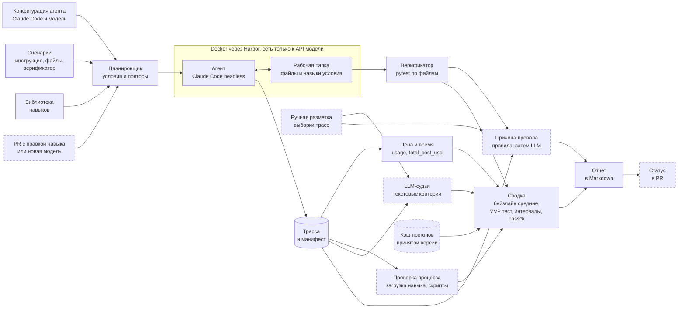

# Дизайн ML-системы. Стенд для тестирования навыков LLM-агентов на задачах с документами и данными

Документ описывает MVP по [шаблону Reliable ML](https://github.com/IrinaGoloshchapova/ml_system_design_doc_ru/blob/main/ML_System_Design_Doc_Template.md). Версия для ДЗ 1, заполнены разделы 1 и 2. Автор Ярослав Рогоза ([@123yaroslav](https://github.com/123yaroslav)), курс ML System Design, ИТМО, 2026.

## Термины

| Термин | Что значит |
|---|---|
| Навык (Agent Skill) | Папка с файлом `SKILL.md` и, при необходимости, скриптами и шаблонами. В `SKILL.md` лежат имя, описание до 1024 символов и инструкция. Формат открыт [7] |
| Библиотека навыков | Навыки, установленные агенту. Агент видит имена и описания всех навыков и сам решает, какой загрузить целиком |
| Харнесс | Программа вокруг модели, которая дает ей инструменты и ведет цикл агента. Например, Claude Code или Codex CLI |
| Сценарий | Инструкция пользователя, входные файлы и верификатор, который проверяет результат кодом |
| Прогон | Один запуск агента на сценарии. Исход случаен, поэтому сценарий запускаем несколько раз |
| Трасса | Журнал прогона. Сообщения, вызовы инструментов, токены, время |
| Условие | Какие навыки видит агент. Без навыков ($c_0$), только проверяемый навык ($c_s$), вся библиотека ($c_L$) |
| Сосед навыка | Навык библиотеки с самым похожим описанием по эмбеддингам. Автор может указать соседа вручную |
| Прирост от навыка | Разница доли успешных прогонов с навыком и без него на одних и тех же сценариях |
| Регрессия | Статистически значимое падение качества новой версии навыка, модели или харнесса относительно принятой |
| MDE | Минимальный эффект, который проверка заметит с вероятностью 80% |
| pass^k | Вероятность, что все k прогонов сценария успешны. Мера надежности [11] |

## 1. Цели и предпосылки

### 1.1. Зачем идем в разработку продукта?

Компании собирают библиотеки навыков для офисной работы агентов. Сверить две выгрузки, собрать отчет в xlsx по внутренним правилам, перенести таблицу из PDF-счета в Excel. Формат навыков поддерживают 46 продуктов, среди них Claude Code, Codex, Gemini CLI и Cursor [7]. Навык пишут обычным текстом и почти не тестируют. Автор пробует его пару раз на своем примере, ревьюер читает diff. Ниже шесть проблем такого процесса и данные о них.

| Проблема | Что известно |
|---|---|
| Неясно, помогает ли навык | В SkillsBench навыки от экспертов подняли долю решенных задач с 33,9% до 50,5%. В том же эксперименте навыки, которые модель написала себе сама, на трех конфигурациях опустили ее в среднем на 10 п.п. На 13 из 87 задач навыки ухудшили результат [1] |
| Эффект навыка зависит от модели | На 23 задачах SkillsBench с документами и данными прирост от навыков у разных моделей от +1 до +29 п.п. На 5 задачах навык одной модели добавляет не меньше 2 успешных прогонов из 3, а другой столько же отнимает. При трех прогонах это ориентир (наш расчет, `scripts/skillsbench_variance.py`) |
| Текст навыка не говорит о его пользе | В ACES статические проверки навыков почти не согласуются с оценками LLM-судьи (ρ = 0,14). Выигрыш от навыка в выборе действий и порядке шагов виден только в живых прогонах [2] |
| В большой библиотеке агент чаще берет не тот навык | При росте библиотеки с 5 до 100 навыков доля нужных среди использованных навыков падает с 29,6% до 3,3% [3] |
| Качество меняется без правок навыка | GPT-4 за три месяца 2023 года упал с 84% до 51% на одной и той же задаче под тем же именем модели [4]. После обновления MCP-серверов успех агентов падает примерно на 14% [5] |
| Навык стоит денег | В SkillsBench Claude Code на Opus 4.7 с навыками тратил 6,74 $ на прогон вместо 5,21 $ без них [1]. Окупается ли рост, без замера неизвестно |

#### Бизнес-цель

Владелец библиотеки принимает навык или его новую версию по измеренному эффекту и цене. Регрессии после правок и обновлений он находит раньше пользователей.

#### Заказчик и пользователи

Реального заказчика у проекта нет. Для пилота моделируем отдел аналитики вымышленной компании, где отчеты готовят через Claude Code. В библиотеке 12 навыков, правок навыков около 5 в неделю. Со стендом работают двое. Автор навыка проверяет свою правку. Владелец библиотеки решает, принять ли ее, и следит за качеством всей библиотеки.

| Шаг | Сейчас | Со стендом |
|---|---|---|
| Новый навык | Пара ручных запусков на своем примере | Прогоны на 6 сценариях с навыком и без него, прирост с доверительным интервалом |
| Ревью правки | Чтение diff `SKILL.md` | Статус в PR, список сломанных сценариев и причины провалов |
| Обновление модели или харнесса | Узнаем от пользователей | Полный прогон библиотеки и список регрессий |
| Решение оставить навык | По впечатлению | По приросту, точности выбора навыка и цене успешного прогона |

#### Почему с ML станет лучше

Код проверяет итоговый файл, но не объясняет провал и не оценивает свободный текст. Поэтому в стенде два места для LLM. Судья проверяет критерии, которые нельзя выразить кодом. Классификатор называет причину провала по трассе вместо ручного разбора. Статистика отделяет регрессию от шума, ведь два одинаковых прогона агента дают разный результат.

#### Успех MVP

Стенд работает на библиотеке из 12 навыков и 60 сценариях и проходит пороги из раздела «Что считаем успешным пилотом». Для бизнеса главное, чтобы сломанные правки навыков не доходили до пользователей, а целые правки не блокировались зря.

### 1.2. Бизнес-требования и ограничения

#### Функциональные требования

| ID | Требование | Как проверим |
|---|---|---|
| FR1 | Агент запускается в изолированной песочнице, начальное состояние у всех прогонов одинаковое | Два прогона видят одни и те же файлы и не видят чужих навыков |
| FR2 | Есть три условия прогона, $c_0$, $c_s$ и $c_L$ | Набор навыков записан в манифесте прогона |
| FR3 | Результат проверяется кодом | У каждого сценария есть верификатор. Эталонное решение его проходит, пустое не проходит |
| FR4 | Проверяется процесс. Загружен ли нужный навык, запускались ли его скрипты, не тронуты ли входные файлы | Правила по трассе сверены с ручной разметкой |
| FR5 | Для каждого прогона считаются токены, доллары, шаги и время | Сумма за неделю расходится с биллингом провайдера меньше чем на 5% |
| FR6 | Две версии навыка, модели или харнесса сравниваются с доверительным интервалом и списком сценариев, сменивших исход | A/A и мутационные тесты из раздела 2.1 |
| FR7 | PR с правкой навыка запускает прогон затронутых сценариев и получает статус | Тестовый PR со сломанным навыком блокируется |
| FR8 | У каждого провала есть причина из фиксированного списка, отчет показывает ее без чтения трассы | Совпадение с ручной разметкой |
| FR9 | Прогон повторяется по манифесту. В нем версии сценариев, навыков, образа, модели и харнесса, трассы сохранены целиком | Повтор по манифесту дает результат в пределах доверительного интервала |

#### Ограничения

- Бюджет на API до 200 $ за семестр, расчет в разделе 2.3. Агент работает на дешевой модели, среднюю берем только для выборочных сравнений.
- Один разработчик, срок до конца курса в декабре 2026 года.
- Только синтетические и открытые документы, персональных данных нет.
- Агент выполняет код, поэтому работает в контейнере. Сеть открыта только к API модели.
- Модели закрытые и недетерминированные. Точной повторяемости нет, поэтому опираемся на повторы и интервалы.
- Документные навыки Anthropic (xlsx, pdf, docx) распространяются по закрытой лицензии [6]. В репозиторий их не кладем, ставим при запуске.
- Проверка PR идет на отдельной машине (self-hosted раннер), чтобы держать 8 контейнеров параллельно. Больше не берем из-за лимитов API. Ключи лежат в секретах репозитория, PR из форков стенд не запускает.

#### Что ожидаем от MVP

1. Библиотеку из 12 навыков. Это 6 своих процедурных навыков вымышленной компании, 3 документных навыка Anthropic и 3 навыка-приманки с похожими описаниями.
2. 60 сценариев с верификаторами. Из них 36 для своих навыков, 12 для документных навыков Anthropic и 12, где навык не нужен.
3. Стенд с CLI на харнессе Claude Code и двух моделях Anthropic, дешевой и средней.
4. Проверку PR с правкой навыка в CI.
5. Результаты проверки самого стенда на A/A и мутациях.

#### Бизнес-процесс пилота

1. Автор открывает PR с правкой навыка. У каждого навыка 6 сценариев, их пишет автор навыка по шаблону.
2. CI находит затронутый навык и его соседа.
3. Стенд прогоняет новую версию в условии $c_L$ на 6 сценариях навыка и 6 сценариях соседа, по 3 раза. Всего 36 прогонов.
4. Прогоны принятой версии стенд берет из кэша. Кэш годен, пока не сменились снимок модели и версия харнесса.
5. Стенд пишет отчет в PR и ставит статус. Красный статус блокирует слияние, владелец библиотеки может снять блок с комментарием.
6. Для нового навыка принятой версии нет. Тогда стенд сравнивает библиотеку с навыком и без него на тех же 12 сценариях.
7. Раз в неделю стенд прогоняет всю библиотеку в условии $c_L$. После смены модели или харнесса он заново считает все три условия.

#### Типичный сценарий использования

Аналитик расширяет описание навыка `reconcile-exports` (сверка выгрузок), чтобы тот срабатывал и на CSV из 1С. Сам навык работает как раньше. Но теперь агент берет его и в задачах соседа `check-data-quality`. Через полчаса в PR появляется отчет. Числа в примере условные.

```text
Навык reconcile-exports, новая версия a1b2c3 против принятой 9f8e7d
Claude Code, дешевая модель, 12 сценариев x 3 прогона, библиотека из 12 навыков

                          принятая   новая      разница, 95% ДИ       p
Успех, сценарии навыка    17 из 18   17 из 18   0 п.п. [-17; 17]      0,50
Успех, сценарии соседа    16 из 18   7 из 18    -50 п.п. [-78; -22]   0,001  РЕГРЕССИЯ
Загружен чужой навык      0 из 36    10 из 36   reconcile-exports в задачах check-data-quality
Цена прогона              0,08 $     0,09 $     +12,5%

Сменили исход 3 сценария соседа (3 из 3 -> 0 из 3): dq-02, dq-04, dq-05
Причина 9 из 12 провалов: загружен чужой навык reconcile-exports
```

Аналитик сужает описание и перезапускает проверку. Другой сценарий такой. Владелец библиотеки видит, что документный навык дает прирост 2 п.п. при росте цены на 30%, и убирает его.

#### Что считаем успешным пилотом

| Метрика | Порог | Откуда порог |
|---|---|---|
| Пойманные мутации навыков (раздел 2.1) | Не меньше 13 из 15 | Свои навыки дают прирост от 30 п.п. (раздел 1.4), мутация, которая выключает навык, роняет успех хотя бы на столько. Два сценария, упавшие с 3 из 3 до 0 из 3, уже значимы |
| Ложные блокировки PR на A/A | ≤ 5% | Уровень значимости решения по PR, два теста по 0,025 |
| Время вердикта по PR | ≤ 40 мин | 36 прогонов до 6 минут (в ACES от 4,3 до 7,5 минуты [2]) на 8 контейнерах, это 5 волн и запуск |
| Цена вердикта по PR | ≤ 5 $ | 36 прогонов примерно по 0,1 $ и вызовы классификатора. Claude Code на Sonnet тратит от 0,25 до 0,29 $ на задачу [14], дешевая модель втрое дешевле |
| Совпадение причины провала с ручной разметкой | ≥ 75% на 100 провалах | Около половины провалов в классах, которые определяют правила, там ждем 95%. На остальных ждем 55% |
| Согласие LLM-судьи с человеком | κ Коэна ≥ 0,7 на 100 прогонах | Существенное согласие по шкале Landis и Koch [15]. При 100 примерах интервал для κ около ±0,13 |

Как метрики пилота связаны с бизнесом.

| Бизнес-метрика | Чем ее приближаем в пилоте |
|---|---|
| Доля сломанных правок, дошедших до пользователей | 1 минус доля пойманных мутаций |
| Время авторов, потерянное на ложные блокировки | Доля ложных блокировок на A/A |
| Время ревью правки | Время вердикта и совпадение причины провала с разметкой |
| Расходы на навыки | Цена успешного прогона и прирост на доллар |

После пилота добавим второй харнесс (Codex), адаптивные повторы, кривую точности выбора навыка от размера библиотеки, генерацию сценариев LLM с проверкой человеком и проверки безопасности навыков из SkillEvaluator.

### 1.3. Что входит в скоуп проекта/итерации, что не входит

#### Входит в MVP

- Харнесс Claude Code в headless-режиме, запуск в Docker через Harbor [8].
- Две модели Anthropic, дешевая и средняя.
- Условия $c_0$, $c_s$ и $c_L$.
- Верификаторы на pytest, проверки процесса по трассе, стоимость и время.
- Статистика. Перестановочный тест внутри сценариев, бутстреп-интервалы, pass^k, MDE, поправки на множественные сравнения.
- Классификатор причин провала на правилах и LLM.
- LLM-судья для текстовых критериев, не больше чем в 20% сценариев.
- CLI, отчет в Markdown, проверка в GitHub Actions.
- Проверка самого стенда на A/A и мутациях.

#### Не входит

| Что | Почему |
|---|---|
| Codex, OpenCode и другие харнессы | Добавим после пилота, Harbor их уже запускает |
| Адаптивные повторы | Экономят прогоны, но меняют распределение статистики. Добавим после калибровки на A/A |
| Проверки безопасности навыков и prompt injection | Это уже умеет SkillEvaluator [2], подключим после пилота |
| Автоматическое улучшение навыков | Другая задача. Стенд дает ей сигнал |
| MCP-серверы и мультиагентные системы | Другой объект тестирования |
| Мониторинг навыков у живых пользователей | Нужны данные продакшена, их нет |
| Внешний вид документов, верстка и графики | Верификаторы проверяют содержимое. Внешний вид отдадим судье по рендеру позже |
| Веб-интерфейс | Для пилота хватает отчета в PR |

#### Качество кода и воспроизводимость

Код проходит ruff, mypy в строгом режиме и pytest в CI, зависимости зафиксированы в `uv.lock`. Каждый прогон пишет манифест с хэшами сценариев и навыков, digest образа, версией харнесса, снимком модели и коммитом стенда. Трассы хранятся целиком, поэтому отчет пересчитывается без новых прогонов.

#### Технический долг

- Один харнесс.
- Трассы и результаты лежат в JSONL и Parquet, без базы данных.
- Цена берется из оценки харнесса, сверка с биллингом ручная и раз в неделю.
- Судья и классификатор работают на промптах без дообучения. Размеченных трасс будет около 200, для дообучения этого мало.
- Параллельность ограничена одной машиной.

### 1.4. Предпосылки решения

1. Исход прогона случаен. Каждый сценарий запускаем 3 раза, единица анализа это сценарий, версии сравниваем парно на одних сценариях. Так рекомендует Miller [9]. Температуру в Claude Code задать нельзя, а детерминизм провайдер не гарантирует.
2. На задачах SkillsBench с документами и данными среднее $p(1-p)$ по ячейкам равно 0,074, в 78% ячеек все три прогона дают одинаковый исход (`scripts/skillsbench_variance.py`). На своих сценариях разброс будет выше, ведь мы калибруем их на успех от 20 до 60% без навыка. Поэтому чувствительность считаем для 0,074 и для худшего случая 0,25 и уточняем по своим прогонам на этапе 2.
3. Результат задачи это файл, который можно проверить кодом. Проверяем значения ячеек, листы, формулы, текст PDF и DOCX. Формулы xlsx перед проверкой пересчитываем в LibreOffice, openpyxl сам их не считает. Судья нужен только для свободного текста, например выводов в отчете.
4. Загрузку навыка видно в трассе. Claude Code загружает навык вызовом инструмента `Skill` [10], поэтому загрузку определяем правилом, без LLM.
5. Агент видит только навыки своего условия. Claude Code подхватывает навыки пользователя, проекта и плагинов, а режим `--bare` отключает поиск навыков совсем [10]. Поэтому прогон идет без `--bare` в контейнере с чистой конфигурацией, навыки условия копируются в `.claude/skills` рабочей папки. Что агент видел нужный набор, проверяем по трассе каждого прогона.
6. Стоимость берем из `total_cost_usd` и `usage` в результате Claude Code. Это оценка клиента, а не счет [10].
7. Модель задаем снимком с датой, версию харнесса фиксируем в образе. Веса снимка провайдер не меняет, поэтому кэш прогонов принятой версии сравним с новыми прогонами. Сдвиг из-за изменений в обслуживании модели ловит еженедельный прогон.
8. Сценарии бывают трех типов. Нужен проверяемый навык, нужен другой навык, навык не нужен. Без последних двух не видно ложных срабатываний и вреда от навыка.
9. Свои сценарии калибруем так, чтобы без навыка агент решал от 20 до 60% из них, а с навыком не меньше чем на 30 п.п. больше. Иначе прирост упирается в ноль или потолок, а мутациям нечего ронять.
10. Результаты храним на уровне «сценарий, условие, прогон». Проверка PR идет на каждую правку навыка, прогон $c_L$ раз в неделю, все три условия после смены модели или харнесса.

## 2. Методология

### 2.1. Постановка задачи

Стенд измеряет эффект навыков и проверяет гипотезы на случайных прогонах агента. Модели мы не обучаем. ML в стенде это две классификации трасс. Судья отвечает да или нет по критерию, классификатор называет причину провала. Статистика сравнивает версии.

#### Обозначения

| Обозначение | Смысл |
|---|---|
| $L = \lbrace s_1, \dots, s_N \rbrace$ | Библиотека навыков |
| $x$ | Сценарий. Инструкция, входные файлы и верификатор $V_x$ |
| $r(x) \in L \cup \lbrace \varnothing \rbrace$ | Навык, нужный в сценарии, или пусто |
| $a$ | Конфигурация агента. Харнесс, модель, параметры |
| $c \in \lbrace c_0, c_s, c_L \rbrace$ | Условие прогона |
| $\tau$ | Трасса прогона, случайная при фиксированных $a, c, x$ |
| $Y = V_x(\tau) \in \lbrace 0, 1 \rbrace$ | Успех по верификатору |
| $A(\tau) \subseteq L$ | Навыки, которые агент загрузил |
| $C(\tau)$, $T(\tau)$ | Стоимость в долларах и время |

#### Метрики

Доля успеха на наборе сценариев $X$

$$p(a, c, X) = \frac{1}{|X|} \sum_{x \in X} \mathbb{E}\left[ Y \mid a, c, x \right].$$

Прирост от навыка $s$ на его сценариях $X_s = \lbrace x \mid r(x) = s \rbrace$ в чистом виде и в библиотеке

$$\Delta_s = p(a, c_s, X_s) - p(a, c_0, X_s), \qquad \Delta_s^L = p(a, c_L, X_s) - p(a, c_0, X_s).$$

Вред библиотеки $p(a, c_L, X_\varnothing) - p(a, c_0, X_\varnothing)$ на сценариях, где навык не нужен. Он должен быть около нуля.

Выбор навыка в условии $c_L$ описывают три числа. Полнота $P(r(x) \in A(\tau))$ на сценариях, где навык нужен. Точность (precision), то есть доля нужного навыка среди загруженных. Ложные срабатывания $P(A(\tau) \neq \varnothing)$ на $X_\varnothing$.

Надежность pass^k при $n$ прогонах и $c$ успехах оцениваем несмещенно как $\binom{c}{k} / \binom{n}{k}$ [11]. Число прогонов фиксировано, иначе оценка смещается. Цена успеха равна $\mathbb{E}[C] / p$.

#### Проверка регрессии

Сравниваем принятую версию $v$ и новую $v'$ навыка, модели или харнесса на одних сценариях. Для сценария $x$ считаем $d_x = \bar Y_x(v') - \bar Y_x(v)$, разницу средних по прогонам, и усредняем по сценариям. Нулевая гипотеза говорит, что внутри каждого сценария версии одинаково успешны. Проверяем ее точным перестановочным тестом внутри сценариев. Метки версий перемешиваем только между прогонами одного сценария, статистика равна сумме $d_x$, тест односторонний. Интервал для разницы строим бутстрепом прогонов внутри сценариев.

Знаковый тест по средним сценариев здесь не годится. Если новая версия сломала 4 сценария из 12, а остальные не изменились, его минимальное p-значение равно $1/16$, и регрессию он пропустит. Тест внутри сценариев видит отдельные поломки. Два сценария, упавшие с 3 из 3 до 0 из 3, при неизменных остальных дают $p = 1/400$.

Такой тест делает вывод о наших сценариях, а не обо всех возможных задачах. Для проверки PR это и нужно. При сравнении моделей на всей библиотеке добавляем кластерный бутстреп по сценариям [9].

Проверка PR ставит две гипотезы, для сценариев навыка и для сценариев соседа. Каждую проверяем на уровне 0,025, так доля ложных блокировок PR не выше 5%. Еженедельный прогон проверяет 12 навыков сразу, там список регрессий строим по процедуре Benjamini и Hochberg с долей ложных находок 10% [16].

#### Чувствительность

При $n$ сценариях и $k$ прогонах на версию

$$\mathrm{MDE} = \left( z_{1-\alpha} + z_{1-\beta} \right) \sqrt{\frac{2\,\overline{p(1-p)}}{k\,n}}, \qquad \alpha = 0{,}05, \quad 1-\beta = 0{,}8.$$

Это нормальное приближение для равномерного сдвига на всех сценариях. На этапе 3 уточним его симуляцией того же теста. Таблицу печатает `uv run python -m skills_testbed.power`.

| Сценариев | Повторов | MDE при p(1-p)=0.25 | MDE при p(1-p)=0.074 |
|---|---|---|---|
| 6 | 3 | 41 п.п. | 23 п.п. |
| 12 | 3 | 29 п.п. | 16 п.п. |
| 48 | 3 | 15 п.п. | 8 п.п. |
| 60 | 3 | 13 п.п. | 7 п.п. |

Проверка PR поэтому видит только крупные поломки. С поправкой на два теста равномерное падение на 6 сценариях навыка она заметит, если оно от 25 до 47 п.п., в зависимости от разброса. Еженедельный прогон видит общий сдвиг по библиотеке от 7 до 13 п.п., но по одному навыку он не чувствительнее проверки PR. Тонкие ухудшения одного навыка стенд не заметит, для этого навыку нужно больше сценариев. Это ограничение стенд пишет в каждом отчете.

#### ML-задачи внутри стенда

##### Классификатор причин провала

Классификатор получает трассу, текст навыка, сценарий и вывод верификатора. Возвращает класс и номер шага, где случилась ошибка. Метрики доля верных ответов (accuracy) и macro-F1 на 100 размеченных вручную провалах. Бейзлайн это только правила, все остальное уходит в класс «прочее».

| Класс | Пример | Как определяем |
|---|---|---|
| Навык не загружен | Нужен `reconcile-exports`, агент его не открыл | Правило по трассе |
| Загружен чужой навык | Агент взял `check-data-quality` | Правило по трассе |
| Шаги навыка не выполнены | Агент пропустил дедупликацию из инструкции | LLM по трассе и тексту навыка |
| Ошибка в навыке | Скрипт навыка упал, инструкция устарела | Код возврата скрипта, затем LLM |
| Ошибка агента вне навыка | Агент неверно разобрал даты | LLM |
| Сбой инфраструктуры | Таймаут API, лимит запросов | Правило. Прогон повторяем и в метрики не берем |
| Ошибка сценария | Верификатор отклоняет верный ответ | Ручной разбор |

##### LLM-судья

Судья проверяет критерии, которые не выразить кодом. Например, совпадает ли вывод в отчете с данными. По каждому критерию ответ да или нет. Метрика κ Коэна с разметкой человека на 100 прогонах. Судья работает на модели другого семейства, чем агент, потому что LLM завышают оценки своим ответам [12].

#### Как проверяем сам стенд

Стенд проверяем тремя способами.

1. Мутации. Портим навык известным способом и смотрим, ловит ли стенд поломку и верно ли называет причину. Пять мутаций на трех своих навыках, всего 15 версий.
2. A/A. Первая часть проверяет сам тест. Прогоны одной версии с 6 повторами много раз случайно делим на две группы по 3, доля тревог должна быть не выше 5%. Вторая часть проверяет дрейф. Сравниваем еженедельные прогоны неизменной библиотеки, это 24 пары «навык, неделя» за пилот.
3. Ручная разметка. 100 провалов для классификатора и 100 прогонов для судьи. 30 трасс размечает второй человек, чтобы оценить согласие разметчиков.

| Мутация | Что меняем в навыке | Что должен показать стенд |
|---|---|---|
| M1 описание | Описание заменяем на нейтральный текст | Падение полноты выбора, причина «навык не загружен» |
| M2 шаг | Удаляем обязательный шаг процедуры | Падение успеха, причина «ошибка в навыке» |
| M3 скрипт | Ломаем скрипт навыка | Падение успеха, причина «ошибка в навыке» по коду возврата |
| M4 правило | Меняем правило, например формат даты | Падение успеха |
| M5 двойник | Добавляем в библиотеку навык с похожим описанием | Падение точности выбора, причина «загружен чужой навык» |

#### Бейзлайн и MVP

Бейзлайн это один прогон на сценарий и сравнение средних. MVP должен обойти его на A/A и мутациях. При разбросе как в SkillsBench правило бейзлайна «успех упал больше чем на 5 п.п.» на 12 сценариях дает ложную тревогу примерно в трети A/A-сравнений. Стандартная ошибка разницы там $\sqrt{2 \cdot 0{,}074 / 12} \approx 0{,}11$, а $\Phi(-0{,}05 / 0{,}11) \approx 0{,}33$. Это приближение, точную долю покажут A/A-прогоны.

| | Бейзлайн | MVP |
|---|---|---|
| Условия | $c_0$ и $c_s$ | $c_0$, $c_s$, $c_L$ с приманками |
| Повторы | 1 | 3 |
| Вывод о регрессии | Разница средних больше 5 п.п. | Перестановочный тест, интервал, поправки, MDE |
| Проверка процесса | Нет | Правила по трассе |
| Причины провала | Нет | Правила и LLM |
| Текстовые критерии | Нет | LLM-судья |
| Запуск | Вручную | CLI и проверка в CI |

### 2.2. Блок-схема решения

Пунктиром показаны блоки, которые добавляет MVP.



Каждый прогон идет в отдельном контейнере, навыки условия кладутся в рабочую папку. Верификатор смотрит на файлы, остальные проверки работают по трассе. В бейзлайне сводка считает средние по условиям, в MVP сравнивает новую версию с принятой.

### 2.3. Этапы решения задачи

| Этап | Что делаем | Результат | Переходим дальше, когда |
|---|---|---|---|
| 1. Данные | Пишем 6 своих навыков, 3 приманки и 60 сценариев с верификаторами | Библиотека и сценарии в формате задач Harbor | Эталонное решение проходит каждый верификатор, пустое не проходит [13] |
| 2. Бейзлайн | Прогоны $c_0$ и $c_s$ по одному разу, отчет со средними | Первые цифры прироста, цена и время прогона | Без навыка агент решает от 20 до 60% своих сценариев, цена прогона измерена |
| 3. Статистика | Повторы, перестановочный тест, поправки, симуляция MDE, A/A | Сравнение версий с интервалом | Ложные тревоги на A/A не выше 5% |
| 4. Причины провала | Правила по трассе, затем LLM, разметка 100 провалов | Классификатор и отчет по причинам | Совпадение с разметкой от 75% |
| 5. Судья | Промпт судьи, разметка 100 прогонов | Проверка текстовых критериев | κ от 0,7 |
| 6. CI и мутации | GitHub Actions, 15 мутированных версий | Проверка PR | Поймано не меньше 13 из 15, вердикт за 40 минут и 5 $ |

#### Данные этапа 1

| Данные | Есть ли сейчас | Кто готовит | Как проверяем качество |
|---|---|---|---|
| 6 своих навыков и 3 приманки | Нет, пишем | Автор | Валидатор спецификации `skills-ref` [7] |
| 36 сценариев для своих навыков, 12 для документных навыков, 12 без навыка | Нет. Входные файлы генерирует скрипт с фиксированным seed | Автор | Эталонное и пустое решение для каждого верификатора |
| 3 документных навыка Anthropic | Да, закрытая лицензия [6] | Ставятся при запуске | Не нужно |
| Ручная разметка 200 трасс | Нет | Автор, 30 трасс второй разметчик | Согласие разметчиков κ |

Задачи SkillsBench в постоянный набор не берем. С моделью уровня Opus они стоят от 5 до 7 $ за прогон [1], один проход по 12 задачам в трех условиях съел бы бюджет. Их опубликованные итоги используем только для оценки разброса.

#### Бюджет прогонов

Цена своего короткого прогона на дешевой модели около 0,1 $. Это оценка, уточним на этапе 2.

| Что | Прогонов | Цена |
|---|---|---|
| Бейзлайн, $c_0$ на 60 сценариях и $c_s$ на 48, по 1 разу | 108 | 11 $ |
| Полный прогон, $c_0$, $c_s$ и $c_L$ по 3 раза | 504 | 50 $ |
| Еще 3 повтора $c_L$ для A/A | 180 | 18 $ |
| Мутации, 15 версий на 6 сценариях по 3 раза и 6 версий на 6 сценариях соседа | 378 | 38 $ |
| Еженедельные прогоны $c_L$, 3 недели пилота | 540 | 54 $ |
| Судья и классификатор | | около 10 $ |
| Итого | 1710 | около 180 $ |

Если прогон окажется дороже, сокращаем число еженедельных прогонов, а не повторы в проверке PR.

## Аналоги

| Решение | Что умеет | Чего не хватает для нашей задачи |
|---|---|---|
| SkillsBench [1] | 87 задач с навыками и верификаторами, прогоны с навыками и без, 18 конфигураций | Это бенчмарк, а не инструмент. Чужую библиотеку и версии навыков он не проверяет |
| NVIDIA SkillEvaluator [2] | Статические проверки, поиск дублей, прогоны с навыком и без, интервал Уилсона для каждой ветки, точный тест Макнемара для пар, гейт в CI | По документации версии 0.6 базой сравнения всегда служит вариант без навыка, две версии навыка напрямую не сравниваются. По умолчанию 1 прогон, причины провалов не классифицирует, приманки подбирают вручную |
| skill-creator от Anthropic [6] | Прогоны с навыком против варианта без него или прошлой версии, среднее и стандартное отклонение успеха, времени и токенов | Нет проверки гипотез и расчета чувствительности, нет выбора навыка из библиотеки и причин провалов |

Берем у аналогов песочницу и формат задач Harbor и парный прогон из ACES. Добавляем сравнение версий с расчетом чувствительности, причины провалов, приманки в библиотеке и цену успеха.

## Риски

| Риск | Что делаем |
|---|---|
| Бюджет кончится до пилота | Дешевая модель, кэш принятой версии, лимит `--max-budget-usd` на прогон, меньше еженедельных прогонов |
| Верификатор пропускает неверное решение | Эталонное и пустое решение для каждого сценария, ручной разбор провалов по чек-листу ABC [13] |
| Свои навыки окажутся слишком простыми или бесполезными | Калибруем сценарии на бейзлайне, держим успех без навыка от 20 до 60% |
| Лимиты API | Не больше 8 параллельных прогонов, повтор с задержкой, сбои уходят в класс «сбой инфраструктуры» |
| Классификатор причин не дотянет до 75% | Оставляем правила, класс от LLM показываем как подсказку |

## Источники

1. SkillsBench. Benchmarking How Well Agent Skills Work Across Diverse Tasks. arXiv 2602.12670, версия 4, 2026. [Статья](https://arxiv.org/abs/2602.12670), [задачи](https://github.com/benchflow-ai/skillsbench), [итоги прогонов](https://github.com/benchflow-ai/skillsbench-trajectories).
2. Evaluating Skills, Not Just Agents. Agentic Continuous Evaluation of Skills (ACES). arXiv 2608.20614, 2026. [Статья](https://arxiv.org/abs/2608.20614), [NVIDIA SkillEvaluator](https://github.com/NVIDIA/SkillEvaluator).
3. Demystifying Agent Skills. Why They Work, Until They Don't. arXiv 2608.14036, 2026. [Статья](https://arxiv.org/abs/2608.14036).
4. Chen, Zaharia, Zou. How is ChatGPT's behavior changing over time? arXiv 2307.09009, 2023. [Статья](https://arxiv.org/abs/2307.09009).
5. MCPEvol-Bench. Benchmarking LLM Agent Performance Across Dynamic Evolutions of MCP Servers. arXiv 2607.14642, 2026. [Статья](https://arxiv.org/abs/2607.14642).
6. Репозиторий навыков Anthropic, включая skill-creator. [GitHub](https://github.com/anthropics/skills).
7. Спецификация Agent Skills, валидатор и список поддерживающих продуктов. [Спецификация](https://agentskills.io/specification), [клиенты](https://agentskills.io/clients), [skills-ref](https://github.com/agentskills/agentskills/tree/main/skills-ref).
8. Harbor, фреймворк для запуска агентов в контейнерах. [GitHub](https://github.com/harbor-framework/harbor).
9. Miller. Adding Error Bars to Evals. arXiv 2411.00640, 2024. [Статья](https://arxiv.org/abs/2411.00640).
10. Документация Claude Code про навыки и headless-режим. [Навыки](https://code.claude.com/docs/en/skills), [headless](https://code.claude.com/docs/en/headless).
11. Yao и др. τ-bench, метрика pass^k. arXiv 2406.12045, 2024. [Статья](https://arxiv.org/abs/2406.12045).
12. Panickssery, Bowman, Feng. LLM Evaluators Recognize and Favor Their Own Generations. arXiv 2404.13076, 2024. [Статья](https://arxiv.org/abs/2404.13076).
13. Zhu и др. Establishing Best Practices for Building Rigorous Agentic Benchmarks (чек-лист ABC). arXiv 2507.02825, 2025. [Статья](https://arxiv.org/abs/2507.02825).
14. SkillFlow. Benchmarking Lifelong Skill Discovery and Evolution for Autonomous Agents. arXiv 2604.17308, 2026, таблица 1. [Статья](https://arxiv.org/abs/2604.17308).
15. Landis, Koch. The Measurement of Observer Agreement for Categorical Data. Biometrics, 33(1), 1977. [JSTOR](https://www.jstor.org/stable/2529310).
16. Benjamini, Hochberg. Controlling the False Discovery Rate. Journal of the Royal Statistical Society B, 57(1), 1995. [JSTOR](https://www.jstor.org/stable/2346101).
