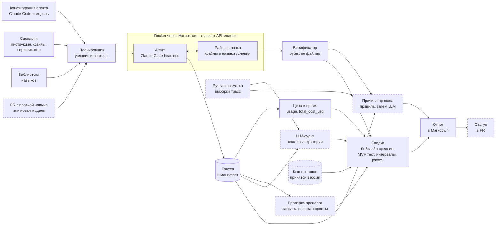

# Дизайн ML-системы. Стенд для тестирования навыков LLM-агентов на задачах с документами и данными

MVP по [шаблону Reliable ML](https://github.com/IrinaGoloshchapova/ml_system_design_doc_ru/blob/main/ML_System_Design_Doc_Template.md), ДЗ 1, разделы 1 и 2. Ярослав Рогоза ([@123yaroslav](https://github.com/123yaroslav)), ML System Design, ИТМО, 2026.

## Термины

| Термин | Что значит |
|---|---|
| Навык | Папка с `SKILL.md` (имя, описание, инструкция) и, если нужно, скриптами. Открытый формат [7] |
| Библиотека | Навыки, установленные агенту. Агент видит их описания и сам решает, какой загрузить |
| Харнесс | Программа, которая ведет цикл агента, например Claude Code |
| Сценарий | Задача, входные файлы и верификатор, который проверяет результат кодом |
| Прогон, трасса | Один запуск агента на сценарии и журнал этого запуска |
| Условие | Какие навыки видит агент. Никаких ($c_0$), только проверяемый ($c_s$), вся библиотека ($c_L$) |
| Сосед | Навык библиотеки с самым похожим описанием |

## 1. Цели и предпосылки

### 1.1. Зачем идем в разработку продукта?

Компании собирают библиотеки навыков для офисной работы агентов, например для сверки выгрузок или отчетов в xlsx. Формат поддерживают 46 продуктов, среди них Claude Code, Codex и Cursor [7]. Навыки пишут текстом и почти не тестируют. Автор пробует навык пару раз, ревьюер читает diff.

| Проблема | Данные |
|---|---|
| Неясно, помогает ли навык | В SkillsBench навыки экспертов подняли успех с 33,9 до 50,5%. Навыки, которые модель написала себе сама, на трех конфигурациях опустили его на 10 п.п. На 13 из 87 задач навыки вредят [1] |
| Эффект зависит от модели | На 5 из 23 задач SkillsBench с документами навык одной модели помогает, а другой мешает (`scripts/skillsbench_variance.py`) |
| В большой библиотеке агент берет не тот навык | При росте библиотеки с 5 до 100 навыков доля нужных среди загруженных падает с 29,6 до 3,3% [3] |
| Качество меняется без правок | GPT-4 за три месяца упал с 84 до 51% на той же задаче [4]. После обновления MCP-серверов успех агентов падает на 14% [5] |
| Навык стоит денег | Claude Code на Opus 4.7 с навыками тратит 6,74 $ на прогон вместо 5,21 $ [1] |

#### Бизнес-цель

Владелец библиотеки принимает навык или правку по измеренному эффекту и цене и находит регрессии раньше пользователей.

#### Заказчик и текущий процесс

Заказчик вымышленный. Отдел аналитики готовит отчеты через Claude Code, в библиотеке 12 навыков, правок около 5 в неделю. Стендом пользуются автор навыка и владелец библиотеки.

| Шаг | Сейчас | Со стендом |
|---|---|---|
| Новый навык | Пара ручных запусков | Прирост на 6 сценариях с интервалом |
| Ревью правки | Чтение diff | Статус в PR, сломанные сценарии и причины |
| Новая модель или харнесс | Узнаем от пользователей | Список регрессий по библиотеке |
| Оставить ли навык | По впечатлению | По приросту, выбору навыка и цене успеха |

#### Почему нужен ML

Верификатор проверяет файл, но не объясняет провал и не оценивает свободный текст. Это делают LLM-классификатор причин и LLM-судья. Статистика отделяет регрессию от шума, потому что одинаковые прогоны агента дают разный результат.

#### Успех итерации

Сломанные правки навыков не доходят до пользователей, а целые не блокируются зря. Пороги в таблице «Успех пилота».

### 1.2. Бизнес-требования и ограничения

#### Функциональные требования

| ID | Требование | Как проверим |
|---|---|---|
| FR1 | Каждый прогон идет в изолированном контейнере с одинаковым начальным состоянием | Прогон не видит чужих навыков и файлов |
| FR2 | Три условия, $c_0$, $c_s$ и $c_L$ | Набор навыков записан в манифесте |
| FR3 | Результат проверяет код | Эталонное решение проходит верификатор, пустое нет |
| FR4 | Процесс проверяется по трассе. Загружен ли нужный навык, запускались ли его скрипты | Сверка с ручной разметкой |
| FR5 | У прогона считаются токены, доллары, шаги и время | Расхождение с биллингом за неделю меньше 5% |
| FR6 | Две версии навыка, модели или харнесса сравниваются с интервалом и списком сценариев, сменивших исход | A/A и мутации |
| FR7 | Правка навыка в PR запускает проверку и ставит статус | PR со сломанным навыком блокируется |
| FR8 | У каждого провала есть причина из фиксированного списка | Сверка с ручной разметкой |
| FR9 | Прогон повторяется по манифесту с версиями сценариев, навыков, образа, модели и харнесса | Повтор попадает в доверительный интервал |

#### Ограничения

- Бюджет на API до 200 $ за семестр, расчет в разделе 2.3.
- Один разработчик, срок до декабря 2026 года.
- Только синтетические данные, без персональных.
- Агент выполняет код, поэтому работает в контейнере с сетью только к API модели.
- Документные навыки Anthropic под закрытой лицензией [6], в репозиторий их не кладем.
- Проверка PR идет на своем раннере, до 8 контейнеров параллельно из-за лимитов API. PR из форков не запускаем.

#### Что ожидаем от MVP

- Библиотеку из 12 навыков. 6 своих, 3 документных навыка Anthropic и 3 приманки с похожими описаниями.
- 60 сценариев. 36 для своих навыков, 12 для документных, 12 без навыка.
- CLI на Claude Code с дешевой и средней моделью Anthropic.
- Проверку PR в CI.
- Отчет о проверке самого стенда на A/A и мутациях.

#### Бизнес-процесс пилота

1. Автор открывает PR с правкой навыка.
2. Стенд прогоняет новую версию в $c_L$ на 6 сценариях навыка и 6 сценариях соседа по 3 раза, всего 36 прогонов. Прогоны принятой версии берет из кэша, пока не сменились снимок модели и версия харнесса.
3. Стенд пишет отчет в PR. Красный статус блокирует слияние, владелец может снять блок с комментарием.
4. Новый навык стенд сравнивает с библиотекой без него на тех же 12 сценариях.
5. Раз в неделю стенд прогоняет всю библиотеку в $c_L$. После смены модели или харнесса прогоняет все три условия.

#### Типичный сценарий

Аналитик расширяет описание навыка `reconcile-exports`, чтобы тот срабатывал на CSV из 1С. Теперь агент берет его и в задачах соседа `check-data-quality`. Через полчаса в PR приходит отчет, числа условные.

```text
reconcile-exports, новая версия a1b2c3 против принятой 9f8e7d
12 сценариев x 3 прогона, библиотека из 12 навыков

                        принятая   новая      разница, 95% ДИ      p
Сценарии навыка         17 из 18   17 из 18   0 п.п. [-17, 17]     0,50
Сценарии соседа         16 из 18   7 из 18    -50 п.п. [-78, -22]  0,001  РЕГРЕССИЯ
Загружен чужой навык    0 из 36    10 из 36
Цена прогона            0,08 $     0,09 $     +12,5%

С 3 из 3 до 0 из 3 упали dq-02, dq-04, dq-05
Причина 9 из 12 провалов: загружен чужой навык reconcile-exports
```

Аналитик сужает описание и перезапускает проверку.

#### Успех пилота

| Метрика | Порог | Бизнес-смысл | Откуда порог |
|---|---|---|---|
| Пойманные мутации | ≥ 13 из 15 | Сломанные правки не доходят до пользователей | Мутация роняет успех на 30 п.п. и больше (предпосылка 8) |
| Ложные блокировки на A/A | ≤ 5% | Авторы не теряют время зря | Уровень значимости решения по PR |
| Время вердикта по PR | ≤ 40 мин | Ревью не ждет | 36 прогонов до 6 минут [2] на 8 контейнерах |
| Цена вердикта по PR | ≤ 5 $ | Проверка правок укладывается в бюджет | 36 прогонов по 0,1 $. Sonnet тратит от 0,25 до 0,29 $ на задачу [14], дешевая модель втрое дешевле |
| Совпадение причины провала с разметкой | ≥ 75% на 100 провалах | Ревьюер не читает трассы | Правила дают около 95% на половине провалов, LLM около 55% на остальных |
| Согласие судьи с человеком | κ ≥ 0,7 на 100 прогонах | Текстовым критериям можно верить | Существенное согласие по Landis и Koch [15] |

### 1.3. Что входит в скоуп проекта/итерации, что не входит

Входит в MVP.

- Claude Code в headless-режиме в Docker через Harbor [8], две модели Anthropic.
- Условия $c_0$, $c_s$ и $c_L$.
- Верификаторы на pytest, проверки процесса по трассе, цена и время.
- Перестановочный тест, бутстреп-интервалы, pass^k, поправки на множественные сравнения.
- Классификатор причин провала и LLM-судья, судья не больше чем в 20% сценариев.
- CLI, отчет в Markdown, проверка в GitHub Actions.

| Не входит | Почему |
|---|---|
| Другие харнессы, Codex и OpenCode | После пилота, Harbor их уже запускает |
| Адаптивные повторы | Ломают уровень значимости теста. Вернемся после A/A |
| Безопасность навыков и prompt injection | Это уже умеет SkillEvaluator [2] |
| Автоматическое улучшение навыков | Другая задача |
| Мониторинг у живых пользователей | Нет данных продакшена |
| Верстка и графики в документах | Верификатор проверяет содержимое |

Код проходит ruff, mypy, pytest и gitleaks в pre-commit и CI. Прогон пишет манифест с хэшами сценариев и навыков, образом, харнессом и снимком модели. Трассы храним целиком, отчет пересчитывается без новых прогонов.

Технический долг. Один харнесс и одна машина, JSONL и Parquet без базы, ручная сверка цены с биллингом, судья и классификатор без дообучения.

### 1.4. Предпосылки решения

1. Исход прогона случаен, температуру в Claude Code задать нельзя. Каждый сценарий запускаем 3 раза, версии сравниваем парно на одних сценариях [9].
2. На задачах SkillsBench с документами и данными в 78% пар «задача, конфигурация» все три прогона дают одинаковый исход. Среднее $p(1-p)$, где $p$ это вероятность успеха сценария, равно 0,074 (`scripts/skillsbench_variance.py`). На своих сценариях разброс будет выше, поэтому чувствительность считаем и для худшего случая 0,25.
3. Результат задачи это файл. Код проверяет ячейки, листы, формулы, текст PDF и DOCX. Формулы xlsx пересчитываем в LibreOffice, openpyxl их не считает. Судья нужен только для свободного текста.
4. Claude Code загружает навык вызовом инструмента `Skill` и отдает цену в `total_cost_usd` [10]. Загрузку определяем правилом по трассе. Цена это оценка клиента, а не счет.
5. Claude Code подхватывает навыки пользователя и плагинов, а режим `--bare` отключает навыки совсем [10]. Поэтому запускаем без `--bare` в контейнере с чистой конфигурацией и по трассе проверяем, что агент видел только навыки условия.
6. Модель задаем снимком с датой, харнесс фиксируем в образе. Поэтому кэш прогонов принятой версии годится для сравнения. Изменения на стороне провайдера ловит еженедельный прогон.
7. Сценарии трех типов. Нужен проверяемый навык, нужен другой навык, навык не нужен. Без последних двух не видно ложных срабатываний и вреда.
8. Сценарии калибруем так, чтобы без навыка агент решал от 20 до 60% из них, а с навыком на 30 п.п. больше. Иначе прирост упирается в ноль или потолок, а мутациям нечего ронять.

## 2. Методология

### 2.1. Постановка задачи

Модели мы не обучаем. Стенд оценивает эффект навыков по случайным прогонам агента. ML в нем это две классификации трассы. Судья отвечает да или нет по текстовому критерию, классификатор называет причину провала.

#### Метрики

Прогон успешен, если верификатор принял результат. Метрики сначала усредняем по прогонам сценария, потом по сценариям.

| Метрика | Как считаем |
|---|---|
| Успех | Доля успешных прогонов |
| Прирост навыка | Успех в $c_s$ или $c_L$ минус успех в $c_0$ на сценариях этого навыка |
| Вред библиотеки | Успех в $c_L$ минус успех в $c_0$ на сценариях без навыка. Должен быть около нуля |
| Полнота выбора | Доля прогонов в $c_L$, где агент загрузил нужный навык |
| Точность выбора | Доля нужного навыка среди загруженных |
| Ложные срабатывания | Доля прогонов на сценариях без навыка, где агент загрузил хоть один навык |
| pass^k | Вероятность, что все $k$ прогонов сценария успешны [11]. Оценка $\binom{m}{k} / \binom{n}{k}$, это число способов выбрать $k$ прогонов из $m$ успешных, деленное на число способов выбрать $k$ из всех $n$ |
| Цена успеха | Средняя цена прогона, деленная на долю успеха |

#### Проверка регрессии

Для каждого сценария считаем разницу долей успеха новой и принятой версии. Нулевая гипотеза говорит, что внутри каждого сценария версии одинаково успешны. Проверяем ее точным перестановочным тестом. Метки версий перемешиваем только между прогонами одного сценария, статистика равна сумме разниц, тест односторонний. Интервал строим бутстрепом прогонов внутри сценариев. Вывод относится к нашим сценариям, а не ко всем задачам, для PR этого достаточно.

Знаковый тест по сценариям здесь не годится. Если сломаны 4 сценария из 12, а остальные не изменились, его минимальное p-значение 1/16. Перестановочный тест видит отдельные поломки. Два сценария, упавшие с 3 из 3 до 0 из 3, дают p = 1/400.

Проверка PR ставит две гипотезы, для навыка и для соседа, каждую на уровне 0,025. Так ложных блокировок не больше 5%. В еженедельном прогоне 12 навыков, там регрессии отбираем по процедуре Benjamini и Hochberg с долей ложных находок 10% [16].

#### Чувствительность

MDE это наименьшее равномерное падение успеха, которое тест заметит с вероятностью 80%. При $n$ сценариях и $k$ повторах на версию

$$\mathrm{MDE} = \left( z_{1-\alpha} + z_{1-\beta} \right) \sqrt{\frac{2\,\overline{p(1-p)}}{k\,n}}.$$

Здесь $\overline{p(1-p)}$ это среднее по сценариям произведение вероятности успеха на вероятность провала. $z_{1-\alpha}$ и $z_{1-\beta}$ это квантили стандартного нормального распределения для уровня значимости $\alpha = 0{,}05$ и мощности $1-\beta = 0{,}8$, в сумме 2,49. Таблицу печатает `uv run python -m skills_testbed.power`.

| Сценариев | Повторов | MDE при p(1-p) = 0,25 | MDE при p(1-p) = 0,074 |
|---|---|---|---|
| 6 | 3 | 41 п.п. | 23 п.п. |
| 12 | 3 | 29 п.п. | 16 п.п. |
| 60 | 3 | 13 п.п. | 7 п.п. |

Проверка PR видит только крупные поломки. С поправкой на два теста это падение от 25 до 47 п.п. на 6 сценариях навыка, в зависимости от разброса. Еженедельный прогон видит сдвиг всей библиотеки от 7 до 13 п.п. Тонкие ухудшения одного навыка стенд не заметит, это ограничение пишем в каждый отчет.

#### Классификатор причин провала

Классификатор получает трассу, текст навыка, сценарий и вывод верификатора и возвращает класс и шаг ошибки. Метрики accuracy и macro-F1 на 100 размеченных провалах. Бейзлайн это одни правила.

| Класс | Пример | Как определяем |
|---|---|---|
| Навык не загружен | Нужен `reconcile-exports`, агент его не открыл | Правило |
| Загружен чужой навык | Агент взял `check-data-quality` | Правило |
| Шаги навыка не выполнены | Агент пропустил дедупликацию из инструкции | LLM |
| Ошибка в навыке | Скрипт навыка упал, инструкция устарела | Код возврата, затем LLM |
| Ошибка агента вне навыка | Агент неверно разобрал даты | LLM |
| Сбой инфраструктуры | Таймаут API | Правило, прогон повторяем |
| Ошибка сценария | Верификатор отклоняет верный ответ | Вручную |

#### LLM-судья

Судья отвечает да или нет по критериям, которые не выразить кодом, например совпадает ли вывод отчета с данными. Качество меряем κ Коэна с разметкой человека на 100 прогонах, это согласие с поправкой на случайные совпадения. Судья работает на модели другого семейства, потому что LLM завышают оценки своим ответам [12].

#### Проверка самого стенда

Мутации. Портим навык известным способом и смотрим, ловит ли стенд поломку и верно ли называет причину. 5 мутаций на 3 своих навыках, всего 15 версий.

| Мутация | Что меняем | Что ждем |
|---|---|---|
| M1 | Описание заменяем нейтральным текстом | Падает полнота выбора, причина «навык не загружен» |
| M2 | Удаляем обязательный шаг | Падает успех, причина «ошибка в навыке» |
| M3 | Ломаем скрипт навыка | Падает успех, причина «ошибка в навыке» |
| M4 | Меняем правило, например формат даты | Падает успех |
| M5 | Добавляем двойника с похожим описанием | Падает точность выбора, причина «загружен чужой навык» |

A/A. Прогоны одной версии с 6 повторами много раз делим на две группы по 3, доля тревог должна быть не выше 5%. Изменения у провайдера ищем сравнением еженедельных прогонов неизменной библиотеки.

Разметка. 100 провалов для классификатора и 100 прогонов для судьи. 30 трасс размечает второй человек, чтобы оценить согласие разметчиков.

#### Бейзлайн и MVP

Бейзлайн запускает сценарий один раз и сравнивает средние. Его правило «успех упал больше чем на 5 п.п.» на 12 сценариях при разбросе как в SkillsBench дает ложную тревогу примерно в трети A/A-сравнений. Стандартная ошибка разницы средних там около 11 п.п., и шум часто дает падение больше 5 п.п.

| | Бейзлайн | MVP |
|---|---|---|
| Условия | $c_0$ и $c_s$ | $c_0$, $c_s$, $c_L$ с приманками |
| Повторы | 1 | 3 |
| Вывод о регрессии | Разница средних больше 5 п.п. | Перестановочный тест, интервал, поправки, MDE |
| Проверка процесса | Нет | Правила по трассе |
| Причины провала | Нет | Правила и LLM |
| Текстовые критерии | Нет | LLM-судья |
| Запуск | Вручную | CLI и проверка в CI |

### 2.2. Блок-схема решения

Пунктиром показаны блоки, которые добавляет MVP.



Верификатор смотрит на файлы, остальные проверки работают по трассе. Бейзлайн считает средние по условиям, MVP сравнивает новую версию с принятой.

### 2.3. Этапы решения задачи

| Этап | Что делаем | Переходим дальше, когда |
|---|---|---|
| 1. Данные | 6 своих навыков, 3 приманки, 60 сценариев с верификаторами в формате Harbor | Эталонное решение проходит каждый верификатор, пустое нет [13] |
| 2. Бейзлайн | Прогоны $c_0$ и $c_s$ по одному разу, отчет со средними | Без навыка агент решает от 20 до 60% сценариев, цена прогона измерена |
| 3. Статистика | Повторы, перестановочный тест, поправки, симуляция MDE, A/A | Ложных тревог на A/A не больше 5% |
| 4. Причины провала | Правила, затем LLM, разметка 100 провалов | Совпадение с разметкой от 75% |
| 5. Судья | Промпт судьи, разметка 100 прогонов | κ от 0,7 |
| 6. CI и мутации | GitHub Actions, 15 мутированных версий | Поймано от 13 из 15, вердикт за 40 минут и 5 $ |

| Данные | Есть ли сейчас | Как проверяем |
|---|---|---|
| 6 своих навыков и 3 приманки | Пишем | Валидатор `skills-ref` [7] |
| 60 сценариев, входные файлы от скрипта с фиксированным seed | Пишем | Эталонное и пустое решение |
| 3 документных навыка Anthropic | Есть, ставятся при запуске [6] | Не нужно |
| Ручная разметка 200 трасс | Размечаем, 30 трасс со вторым разметчиком | Согласие разметчиков κ |

Задачи SkillsBench не берем, на модели уровня Opus их прогон стоит от 5 до 7 $ [1]. Их опубликованные итоги нужны только для оценки разброса.

Бюджет при цене прогона на дешевой модели около 0,1 $. Если прогон выйдет дороже, режем еженедельные прогоны, а не повторы в проверке PR.

| Что | Прогонов | Цена |
|---|---|---|
| Бейзлайн | 108 | 11 $ |
| Три условия по 3 раза | 504 | 50 $ |
| Повторы для A/A | 180 | 18 $ |
| Мутации | 378 | 38 $ |
| Еженедельные прогоны, 3 недели | 540 | 54 $ |
| Судья и классификатор | | 10 $ |
| Итого | 1710 | 180 $ |

## Аналоги

Ближе всего NVIDIA SkillEvaluator [2]. Он прогоняет агента с навыком и без, считает тест Макнемара и ставит гейт в CI. Но в версии 0.6 он сравнивает только с вариантом без навыка, по умолчанию делает 1 прогон и не называет причины провалов. SkillsBench [1] это бенчмарк, чужую библиотеку он не проверяет. skill-creator [6] сравнивает версии навыка по среднему без проверки гипотез. Мы добавляем сравнение версий с расчетом чувствительности, приманки в библиотеке, причины провалов и цену успеха.

## Риски

| Риск | Что делаем |
|---|---|
| Кончится бюджет | Дешевая модель, кэш, лимит `--max-budget-usd` на прогон, реже еженедельные прогоны |
| Верификатор пропускает неверное решение | Эталонное и пустое решение, чек-лист ABC [13] |
| Свои навыки слишком простые или бесполезные | Калибровка на бейзлайне |
| Лимиты API | До 8 параллельных прогонов, повтор с задержкой |
| Классификатор ниже 75% | Оставляем правила, класс от LLM показываем как подсказку |

## Источники

1. SkillsBench. arXiv 2602.12670 v4, 2026. [Статья](https://arxiv.org/abs/2602.12670), [задачи](https://github.com/benchflow-ai/skillsbench), [итоги прогонов](https://github.com/benchflow-ai/skillsbench-trajectories).
2. Evaluating Skills, Not Just Agents (ACES). arXiv 2608.20614, 2026. [Статья](https://arxiv.org/abs/2608.20614), [NVIDIA SkillEvaluator](https://github.com/NVIDIA/SkillEvaluator).
3. Demystifying Agent Skills. arXiv 2608.14036, 2026. [Статья](https://arxiv.org/abs/2608.14036).
4. Chen, Zaharia, Zou. How is ChatGPT's behavior changing over time? arXiv 2307.09009, 2023. [Статья](https://arxiv.org/abs/2307.09009).
5. MCPEvol-Bench. arXiv 2607.14642, 2026. [Статья](https://arxiv.org/abs/2607.14642).
6. Навыки Anthropic и skill-creator. [GitHub](https://github.com/anthropics/skills).
7. Спецификация Agent Skills. [Спецификация](https://agentskills.io/specification), [клиенты](https://agentskills.io/clients), [skills-ref](https://github.com/agentskills/agentskills/tree/main/skills-ref).
8. Harbor. [GitHub](https://github.com/harbor-framework/harbor).
9. Miller. Adding Error Bars to Evals. arXiv 2411.00640, 2024. [Статья](https://arxiv.org/abs/2411.00640).
10. Claude Code. [Навыки](https://code.claude.com/docs/en/skills), [headless](https://code.claude.com/docs/en/headless).
11. Yao и др. τ-bench. arXiv 2406.12045, 2024. [Статья](https://arxiv.org/abs/2406.12045).
12. Panickssery, Bowman, Feng. LLM Evaluators Recognize and Favor Their Own Generations. arXiv 2404.13076, 2024. [Статья](https://arxiv.org/abs/2404.13076).
13. Zhu и др. Agentic Benchmark Checklist (ABC). arXiv 2507.02825, 2025. [Статья](https://arxiv.org/abs/2507.02825).
14. SkillFlow. arXiv 2604.17308, 2026, таблица 1. [Статья](https://arxiv.org/abs/2604.17308).
15. Landis, Koch. The Measurement of Observer Agreement for Categorical Data. Biometrics, 1977. [JSTOR](https://www.jstor.org/stable/2529310).
16. Benjamini, Hochberg. Controlling the False Discovery Rate. JRSS B, 1995. [JSTOR](https://www.jstor.org/stable/2346101).
