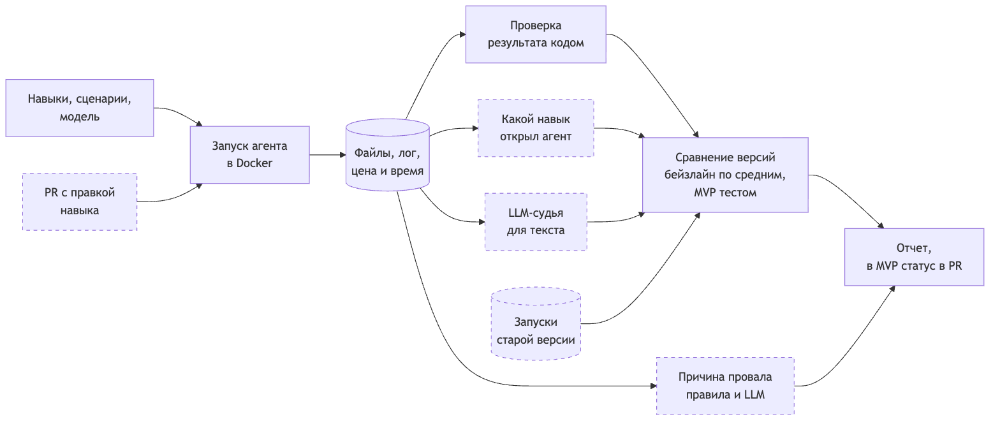

# Стенд для тестирования навыков LLM-агентов

Дизайн-документ по [шаблону Reliable ML](https://github.com/IrinaGoloshchapova/ml_system_design_doc_ru/blob/main/ML_System_Design_Doc_Template.md), разделы 1 и 2. Ярослав Рогоза, ML System Design, ИТМО, 2026.

## 1. Цели и предпосылки

### 1.1. Зачем идем в разработку продукта?

Агентам вроде Claude Code и Codex сейчас дают навыки (Agent Skills). Навык это папка с инструкцией и скриптами под конкретную работу. Например, сверить две выгрузки или собрать отчет в Excel по правилам компании. Агент сам решает, какой навык взять под задачу.

Навыки пишут обычным текстом и проверяют руками на паре примеров. Поэтому никто толком не знает, помогает навык или мешает. В [SkillsBench](https://arxiv.org/abs/2602.12670) навыки от экспертов подняли долю решенных задач с 34 до 51%, а навыки, которые модель написала себе сама, иногда ее снижали. Еще агент может взять не тот навык, и чем больше библиотека, тем чаще это [происходит](https://arxiv.org/abs/2608.14036). Хватит одной неудачной правки описания, чтобы навык начал перехватывать чужие задачи. А иногда качество падает вообще без правок, просто после обновления модели. GPT-4 за три месяца 2023 года стал решать одну и ту же задачу в 51% случаев вместо [84%](https://arxiv.org/abs/2307.09009).

Одним запуском это не проверить, потому что агент на одну и ту же задачу отвечает по-разному.

#### Бизнес-цель

Принимать навыки и правки по цифрам, а не на глаз, и ловить поломки раньше пользователей.

#### Заказчик и текущий процесс

Реального заказчика нет. Беру условный отдел аналитики, который делает отчеты через Claude Code. У них 12 навыков и примерно 5 правок в неделю. Стендом пользуются автор навыка и тот, кто принимает правки.

Сейчас автор пробует навык пару раз, ревьюер читает diff, а о проблемах после обновления модели узнают от пользователей. Со стендом на каждый PR с правкой приходит отчет, что сломалось и почему. После обновления модели вся библиотека прогоняется заново.

#### Где тут ML

Код может проверить итоговый файл, но не скажет, почему агент ошибся. Это по логу определяет LLM. Еще LLM оценивает текст, который кодом не проверить, например выводы в отчете. Статистика нужна, чтобы отличить поломку от случайного разброса.

#### Успех итерации

Сломанные правки не доходят до пользователей, а нормальные не блокируются зря.

### 1.2. Бизнес-требования и ограничения

#### Что должен уметь стенд

- Запускать агента в Docker, каждый раз с одними и теми же файлами.
- Гонять сценарий без навыков, с одним навыком и со всей библиотекой.
- Проверять результат кодом и смотреть по логу, какой навык открыл агент.
- Считать цену и время каждого запуска.
- Сравнивать две версии навыка или модели и говорить, стало ли хуже.
- Называть причину каждого провала.
- Проверять PR с правкой навыка и ставить статус.
- Сохранять версии всего, что было в запуске, чтобы его можно было повторить.

#### Ограничения

Бюджет на API около 200 долларов на семестр. Делаю один, срок до декабря 2026 года. Данные только синтетические. Агент выполняет код, поэтому сидит в контейнере, и наружу ему открыт только API модели. Параллельно не больше 8 запусков, иначе упремся в лимиты API.

#### Что хотим получить в MVP

12 навыков. Из них 6 своих, 3 готовых от Anthropic для xlsx, pdf и docx и 3 двойника с похожими описаниями, чтобы проверить, путает ли их агент. 60 сценариев, в 12 из них навык не нужен вообще. Стенд на Claude Code с двумя моделями, дешевой и средней. Проверка PR в GitHub Actions.

#### Как будет работать пилот

1. Автор открывает PR с правкой навыка.
2. Стенд гоняет новую версию на 6 сценариях этого навыка и 6 сценариях соседнего, у которого самое похожее описание. Каждый сценарий 3 раза, всего 36 запусков.
3. Запуски старой версии берутся из кэша.
4. В PR приходит отчет. Если стало хуже, PR блокируется, но владелец библиотеки может снять блок.
5. Раз в неделю стенд прогоняет всю библиотеку.

#### Пример

Аналитик расширил описание навыка `reconcile-exports` (сверка выгрузок), чтобы он работал еще и с CSV из 1С. Сам навык работает как раньше, но агент начал брать его в задачах соседнего навыка `check-data-quality`. Через полчаса в PR приходит такой отчет, цифры условные.

```text
reconcile-exports, новая версия против старой, 36 запусков
Задачи навыка    17 из 18 -> 17 из 18   без изменений
Задачи соседа    16 из 18 ->  7 из 18   стало хуже, p = 0,001
9 из 12 провалов: агент открыл reconcile-exports вместо check-data-quality
```

Аналитик сужает описание и запускает проверку еще раз.

#### Критерии успеха пилота

| Что меряем | Порог | Зачем |
|---|---|---|
| Сколько испорченных навыков поймал стенд | 13 из 15 | Сломанные правки не доходят до пользователей |
| Ложные блокировки PR | не больше 5% | Авторы не ждут зря |
| Время проверки PR | до 40 минут | Ревью не стоит |
| Цена проверки PR | до 5 долларов | Укладываемся в бюджет |
| Причина провала совпала с ручной разметкой | от 75% | Логи не надо читать руками |
| Оценка LLM-судьи совпала с человеком | κ от 0,7 | Судье можно верить |

Один запуск идет до 6 минут и стоит около 10 центов. 36 запусков на 8 контейнерах это 5 волн, около 30 минут и 4 долларов. Испорченный навык роняет долю успеха на 30 п.п. и больше, такое падение тест ловит, поэтому ждем 13 из 15. κ Коэна показывает согласие двух разметчиков с поправкой на случайные совпадения, 0,7 обычно считают хорошим согласием.

### 1.3. Что входит в скоуп проекта/итерации, что не входит

В MVP входит запуск Claude Code в Docker через [Harbor](https://github.com/harbor-framework/harbor), запуски без навыков, с одним навыком и со всей библиотекой, проверка результата кодом, цена и время, сравнение версий тестом, причины провалов, LLM-судья и отчет в PR.

Что не входит.

- Другие агенты, например Codex. Добавлю после пилота.
- Безопасность навыков. Это уже есть в [NVIDIA SkillEvaluator](https://github.com/NVIDIA/SkillEvaluator).
- Автоматическое улучшение навыков. Это отдельная задача.
- Внешний вид документов. Проверяем только содержимое.

Код проверяют ruff, mypy, pytest и pre-commit, то же самое гоняется в CI. У каждого запуска сохраняются версии сценария, навыка, модели и агента, так что любой запуск можно повторить.

Техдолг. Один агент, одна машина, файлы вместо базы, судья и классификатор на промптах без дообучения.

### 1.4. Предпосылки решения

- Агент на одну задачу отвечает по-разному, поэтому каждый сценарий гоняем 3 раза и сравниваем версии на одних и тех же сценариях.
- Трех раз должно хватить. Я посчитал по открытым результатам SkillsBench, на задачах с документами в 78% случаев все три запуска дают одинаковый результат (`scripts/skillsbench_variance.py`).
- Результат задачи это файл, например xlsx, csv или pdf. Его можно проверить кодом.
- По логу Claude Code видно, какой навык открыл агент и сколько стоил запуск.
- Каждый запуск идет в чистом контейнере, поэтому агент видит только те навыки, которые мы ему дали.
- Версия модели зафиксирована, поэтому старые запуски можно переиспользовать.
- Сценарии подбираем так, чтобы без навыка агент решал от 20 до 60%. Если он решает все или ничего, пользу навыка не измерить.

## 2. Методология

### 2.1. Постановка задачи

Модель мы не обучаем. Стенд меряет, помогает ли навык и не стало ли хуже после правки. ML тут в двух местах. LLM определяет причину провала по логу, а LLM-судья оценивает текст.

#### Метрики

| Метрика | Что показывает |
|---|---|
| Доля успешных запусков | Как часто агент решает задачу |
| Польза навыка | Насколько чаще агент решает задачу с навыком, чем без него |
| Точность выбора | Как часто агент берет из библиотеки нужный навык |
| Ложные срабатывания | Как часто агент берет навык там, где он не нужен |
| pass^3 | Доля сценариев, которые агент решил во всех трех запусках. Метрика из бенчмарка τ-bench. Пользователю важно, чтобы агент справлялся каждый раз, а не один раз из трех |
| Цена успеха | Сколько стоит одно успешное решение |

#### Сравнение версий

Новую и старую версию гоняем на одних и тех же сценариях по 3 раза. Стало ли хуже, проверяем перестановочным тестом. Он много раз перемешивает метки «новая» и «старая» внутри каждого сценария и смотрит, как часто случайное перемешивание дает такое же падение. Если редко, значит, это не случайность. Задачи навыка и задачи соседа проверяем отдельно, каждые на уровне 2,5%, чтобы в сумме ложных блокировок было не больше 5%.

На 6 сценариях по 3 запуска тест с вероятностью 80% ловит падение доли успеха на 25 п.п. и больше. Если разброс большой, то только на 47 п.п. и больше. Мелкие ухудшения он пропустит, об этом пишем в отчете. Расчет печатает `uv run python -m skills_testbed.power`.

#### Причины провалов

LLM читает лог провалившегося запуска и выбирает причину из списка. Агент не открыл нужный навык, открыл чужой, пропустил шаг, ошибка в самом навыке, ошибка агента, упала инфраструктура или ошибка в сценарии. Первые два случая и падения инфраструктуры ловим простыми правилами без LLM. Качество проверяем на 100 провалах, размеченных руками.

#### LLM-судья

Если результат нельзя проверить кодом, например выводы в отчете, судья отвечает да или нет по критерию. Судья работает на модели другого производителя, потому что модели [завышают оценки своим ответам](https://arxiv.org/abs/2404.13076). Его ответы сверяем с человеком на 100 запусках.

#### Как проверяем сам стенд

Сами портим навыки пятью способами. Делаем описание размытым, удаляем шаг, ломаем скрипт, меняем правило, добавляем похожий навык-двойник. На трех навыках это 15 испорченных версий, и стенд должен поймать хотя бы 13. Ложные тревоги проверяем A/A-тестом, то есть сравниваем запуски одной и той же версии между собой. Тревог там должно быть не больше 5%.

#### Бейзлайн и MVP

Бейзлайн запускает каждый сценарий один раз и сравнивает доли успеха. Он часто ошибается из-за случайности. Если считать поломкой падение больше 5 п.п., на 12 сценариях он поднимет ложную тревогу примерно в трети случаев.

| | Бейзлайн | MVP |
|---|---|---|
| Запусков на сценарий | 1 | 3 |
| Как решаем, что стало хуже | Падение больше 5 п.п. | Статистический тест |
| Выбор навыка из библиотеки | Не проверяем | Проверяем |
| Причины провалов | Нет | Правила и LLM |
| Запуск | Руками | Сам на каждый PR |

### 2.2. Блок-схема решения



Пунктиром отмечено то, что MVP добавляет к бейзлайну. Исходник схемы лежит в [`flowchart.mmd`](flowchart.mmd).

### 2.3. Этапы решения задачи

| Этап | Что получаем |
|---|---|
| 1. Данные | 6 своих навыков, 3 двойника, 60 сценариев с проверкой кодом |
| 2. Бейзлайн | Первые доли успеха, цена и время запуска |
| 3. Статистика | Сравнение версий, A/A-тест |
| 4. Причины провалов и судья | Классификатор и судья, сверенные с ручной разметкой |
| 5. CI | Проверка PR, прогон 15 испорченных навыков |

Сценарии и входные файлы генерируем скриптом с фиксированным seed. Навыки Anthropic ставим при запуске, их лицензия не разрешает класть их в репозиторий. Задачи из SkillsBench не берем, на сильной модели один запуск там стоит от 5 до 7 долларов.

Бюджет примерно 1700 запусков по 10 центов и еще около 10 долларов на вызовы LLM, всего около 180 долларов. Если запуски выйдут дороже, сократим еженедельные прогоны.

## Аналоги

Ближе всего [NVIDIA SkillEvaluator](https://github.com/NVIDIA/SkillEvaluator). Он сравнивает агента с навыком и без него, но, судя по документации, не сравнивает две версии навыка между собой и не называет причины провалов. SkillsBench это набор задач, а не инструмент для проверки своей библиотеки.
