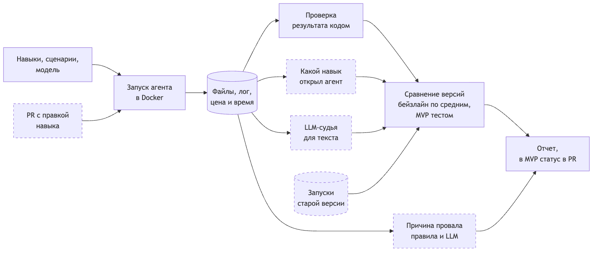

# Стенд для тестирования навыков LLM-агентов

Дизайн-документ по [шаблону Reliable ML](https://github.com/IrinaGoloshchapova/ml_system_design_doc_ru/blob/main/ML_System_Design_Doc_Template.md), разделы 1 и 2. Ярослав Рогоза, ML System Design, ИТМО, 2026.

## 1. Цели и предпосылки

### 1.1. Зачем идем в разработку продукта?

Агентам вроде Claude Code и Codex сейчас дают навыки (Agent Skills). Навык это папка с инструкцией и скриптами под конкретную работу, например сверить две выгрузки или собрать отчет в Excel по правилам компании. Агент сам решает, какой навык взять под задачу.

Навыки пишут обычным текстом и проверяют руками на паре примеров, поэтому никто толком не знает, помогает навык или мешает. В бенчмарке [SkillsBench](https://arxiv.org/abs/2602.12670) хорошие навыки заметно поднимали долю решенных задач, а навыки, которые модель написала себе сама, иногда ее снижали. Агент может взять не тот навык, особенно когда навыков много. Хватит одной неудачной правки описания, чтобы навык начал перехватывать чужие задачи. А иногда качество падает вообще без правок, просто после обновления модели.

Одним запуском это не проверить, потому что агент на одну и ту же задачу отвечает по-разному.

#### Бизнес-цель

Принимать навыки и правки по цифрам, а не на глаз, и ловить поломки раньше пользователей.

#### Заказчик и текущий процесс

Реального заказчика нет. Беру условный отдел аналитики, который делает отчеты через Claude Code. У них 12 навыков, и их правят несколько раз в неделю. Стендом пользуются автор навыка и тот, кто принимает правки.

Сейчас автор пробует навык пару раз, ревьюер читает diff, а о проблемах после обновления модели узнают от пользователей. Со стендом на каждый PR с правкой приходит отчет, что сломалось и почему. После обновления модели вся библиотека прогоняется заново.

#### Где тут ML

Код может проверить итоговый файл, но не скажет, почему агент ошибся. Это по логу определяет LLM. Еще LLM оценивает текст, который кодом не проверить, например выводы в отчете. Статистика нужна, чтобы отличить поломку от случайного разброса.

#### Успех итерации

Сломанные правки не доходят до пользователей, а нормальные не блокируются зря.

### 1.2. Бизнес-требования и ограничения

#### Что должен уметь стенд

Стенд запускает агента в Docker, каждый раз с одними и теми же файлами. Один сценарий можно прогнать без навыков, с одним навыком и со всей библиотекой. Результат проверяет код, а по логу видно, какой навык открыл агент, сколько стоил запуск и сколько он шел.

Стенд сравнивает две версии навыка или модели и говорит, стало ли хуже. Для каждого провала он называет причину. На каждый PR с правкой навыка он ставит статус. Все версии, которые участвовали в запуске, сохраняются, так что любой запуск можно повторить.

#### Ограничения

Бюджет на API около 200 долларов на семестр. Делаю один, срок до декабря. Данные только синтетические. Агент выполняет код, поэтому сидит в контейнере, и наружу ему открыт только API модели.

#### Что хотим получить в MVP

В MVP будет 12 навыков. Половина своих, еще 3 готовых от Anthropic для xlsx, pdf и docx и 3 двойника с похожими описаниями, чтобы проверить, путает ли их агент. К ним 60 сценариев, и в части из них навык не нужен вообще. Агент Claude Code на двух моделях, дешевой и средней. Проверка PR идет в GitHub Actions.

#### Как будет работать пилот

Автор открывает PR с правкой навыка. Стенд гоняет новую версию на сценариях этого навыка и соседнего, у которого самое похожее описание. Каждый сценарий идет 3 раза, а если результат спорный, еще 2 раза. Запуски старой версии берутся из кэша. В PR приходит отчет. Если стало хуже, PR блокируется, но владелец библиотеки может снять блок. Раз в неделю стенд прогоняет всю библиотеку.

#### Пример

Аналитик расширил описание навыка сверки выгрузок, чтобы он работал еще и с CSV из 1С. Сам навык работает как раньше, но агент начал брать его в задачах соседнего навыка, который проверяет качество данных. Через полчаса в PR приходит отчет. На своих задачах навыка ничего не поменялось, а задачи соседа агент теперь решает в 7 случаях из 18 вместо 16. В большинстве провалов он открыл не тот навык. Аналитик сужает описание и запускает проверку еще раз.

#### Критерии успеха пилота

| Что меряем | Порог | Что это дает |
|---|---|---|
| Сколько специально испорченных навыков поймал стенд | 13 из 15 | Сломанные правки не доходят до пользователей |
| Ложные блокировки PR | не больше 5% | Авторы не ждут зря |
| Время и цена проверки одного PR | первый статус до 40 минут, в среднем до 5 долларов | Ревью не тормозит, бюджет не уходит |
| Совпадение причины провала с ручной разметкой | от 75% | Логи не надо читать руками |
| Согласие LLM-судьи с человеком | каппа Коэна от 0,7 | Судье можно верить |

Время и цену посчитали так. На проверку PR нужно 36 запусков, они идут по 8 параллельно. В логах SkillsBench медианный запуск Claude Code на документах идет около 5 минут, но каждый десятый дольше 25 минут. Поэтому на запуск стоит лимит 10 минут, и тогда проверка почти всегда идет меньше 30 минут ([EDA](../notebooks/eda.ipynb), раздел 6). Если результат спорный, стенд добирает еще 48 запусков. Окончательный статус тогда приходит примерно через час, а первый все равно до 40 минут. Цены в открытых данных нет. По прикидке запуск стоит около 10 центов, точную цифру даст бейзлайн. Как от нее зависит размер пилота, описано в 3.3. Как считаем каждый критерий, описано в 3.2.

### 1.3. Что входит в скоуп проекта/итерации, что не входит

В MVP входит все, что описано выше, для одного агента Claude Code. Другие агенты, например Codex, добавлю после пилота. Безопасность навыков не проверяю, это уже умеет [NVIDIA SkillEvaluator](https://github.com/NVIDIA/SkillEvaluator). Автоматически улучшать навыки стенд не будет, это отдельная задача. Внешний вид документов тоже не проверяем, только содержимое.

Код проверяют ruff, mypy и pytest через pre-commit и в CI. Техдолг на этом этапе такой. Один агент и одна машина, результаты в файлах без базы, судья и классификатор на промптах без дообучения.

### 1.4. Предпосылки решения

Агент на одну задачу отвечает по-разному, поэтому каждый сценарий гоняем 3 раза. Я проверил это на открытых результатах SkillsBench. На задачах с документами в трех случаях из четырех все три запуска дают одинаковый результат, так что трех раз хватит, чтобы заметить крупные поломки ([EDA](../notebooks/eda.ipynb), раздел 3).

Результат задачи это файл, например xlsx или pdf, и его можно проверить кодом. По логу Claude Code видно, какой навык открыл агент и сколько стоил запуск. Каждый запуск идет в чистом контейнере, поэтому агент видит только те навыки, которые мы ему дали. Версия модели зафиксирована, так что старые запуски можно переиспользовать.

Сценарии подбираем так, чтобы без навыка агент решал часть из них, но не все. Если он решает все или ничего, пользу навыка не измерить.

## 2. Методология

### 2.1. Постановка задачи

Модель мы не обучаем. Стенд меряет, помогает ли навык и не стало ли хуже после правки. ML тут в двух местах. LLM по логу определяет причину провала, а LLM-судья оценивает текст.

Главная метрика это доля успешных запусков. Из нее считаем пользу навыка, то есть насколько чаще агент решает задачу с навыком, чем без него. Отдельно смотрим, как часто агент берет из библиотеки нужный навык и как часто берет навык там, где он не нужен. Еще считаем, сколько сценариев агент решил во всех трех запусках, потому что пользователю важно, чтобы агент справлялся каждый раз. И считаем цену одного успешного решения.

Чтобы понять, стало ли хуже, новую и старую версию гоняем на одних и тех же сценариях и сравниваем перестановочным тестом. Тест много раз случайно перемешивает метки «новая» и «старая» и смотрит, как часто такое же падение получается просто случайно. Если редко, значит, версия правда стала хуже. Порог подобран так, чтобы ложных блокировок было не больше 5%. На таком маленьком наборе сценариев тест ловит только крупные поломки. Мелкие ухудшения он пропустит, и это написано в каждом отчете.

Причину провала LLM выбирает по логу из короткого списка. Агент не открыл нужный навык, открыл чужой, пропустил шаг, ошибка в самом навыке, ошибка агента, сбой инфраструктуры, ошибка в сценарии или попытка подсмотреть проверку. Простые случаи вроде «не открыл навык» ловим правилами без LLM. Качество сверяем с ручной разметкой ста провалов.

LLM-судья нужен там, где результат нельзя проверить кодом, например для выводов в отчете. Он отвечает да или нет и работает на модели другого производителя, потому что модели [завышают оценки своим ответам](https://arxiv.org/abs/2404.13076). Его ответы тоже сверяем с человеком.

Сам стенд проверяем так. Специально портим навыки, например удаляем шаг или ломаем скрипт, и смотрим, поймает ли стенд поломку. Ложные тревоги проверяем A/A-тестом, то есть сравниваем запуски одной и той же версии между собой.

Бейзлайн запускает каждый сценарий один раз и сравнивает доли успеха. Из-за случайности он часто поднимает ложную тревогу. MVP добавляет повторы, статистический тест, проверку выбора навыка, причины провалов и автоматический запуск на каждый PR.

### 2.2. Блок-схема решения

Пунктиром отмечено то, что MVP добавляет к бейзлайну. Исходник схемы лежит в [`flowchart.mmd`](flowchart.mmd).

### 2.3. Этапы решения задачи

Этапы 1 и 2 есть в шаблоне. Этапы 3, 4 и 5 нужны именно этой задаче. Модель здесь не обучается, зато ошибиться может сам стенд, его надо встроить в PR и проверить на живых правках. В каждом этапе пишу, что делает бейзлайн и что добавляет MVP. Цифры взяты из [EDA](../notebooks/eda.ipynb) на открытых данных SkillsBench, своих запусков пока нет.

| Этап | Что на выходе |
|---|---|
| 1. Подготовка данных | Навыки, сценарии с проверкой, таблица запусков, разметка провалов |
| 2. Подготовка моделей | Правила и промпты классификатора и судьи, настроенный тест |
| 3. Проверка самого стенда | Доля пойманных поломок и ложных блокировок |
| 4. Правила статуса и проверка в PR | Статус и отчет в каждом PR с правкой навыка |
| 5. Пилот | Отчет по пилоту и план второй итерации |

#### Этап 1. Подготовка данных

Данные стенда это навыки, сценарии и логи запусков. Целевая переменная запуска это успех, то есть прошла ли проверка кодом. Для классификатора целевая переменная это причина провала из списка в 2.1, для судьи ответ да или нет на вопрос о тексте.

| Данные | Есть сейчас | Как получаем | Качество проверено |
|---|---|---|---|
| 12 навыков | 3 навыка Anthropic | Свои 6 и 3 двойника пишу сам | Нет, проверит бейзлайн |
| Около 60 сценариев с файлами и проверкой | Нет | Генератор на Python | Нет, проверит бейзлайн |
| Логи запусков, цена и время | Нет | Стенд пишет при каждом запуске | Разбор лога проверен на логах SkillsBench |
| Причины ста провалов | Нет | Ручная разметка | Нет |
| Ответы для проверки судьи | Нет | Ручная разметка | Нет |
| Открытые запуски SkillsBench | Есть, 6513 запусков и 432 лога Claude Code | Скрипт загрузки | Да, в EDA |

**Что показал EDA.** Открытые данные SkillsBench ближе всего к нашим логам. Там тот же Claude Code, задачи в Docker и по три запуска на условие. Проблем в них много, и почти все будут и у нас. В 15 задачах из 87 нет ни одного запуска, почти четверть запусков упала по таймауту, токенов и цены нет совсем. В трех запусках без навыков агент все равно открыл навык, то есть условие эксперимента нарушено. Официальный подсчет выбрасывает таймауты, и доля успеха от этого растет с 33% до 42%.

Отсюда правила подготовки данных. Таймаут считаем провалом, а не выбрасываем, и отмечаем в таблице отдельно. Цену и время стенд пишет сам из вывода Claude Code. Запуск без навыка, в логе которого есть вызов навыка, считается недействительным. Обрезанный лог или ошибка запуска означают сбой инфраструктуры, такой запуск не идет в сравнение и перезапускается.

Второй риск касается самих сценариев. У Claude Code на документах 7 задач из 21 не решаются ни с навыком, ни без, а 4 решаются всегда. На таких задачах поломку навыка не увидеть. Поэтому сценарий попадает в набор, только если на бейзлайне с навыком агент решает его хотя бы в двух запусках из трех, а без навыка не во всех. Для сценариев, где навык не нужен, правило обратное, агент должен решать их и без навыка. Запуски отбора в сравнение версий не идут. В набор попадут и сценарии, которым на отборе повезло, а в следующих запусках они в среднем решаются хуже. Если сравнивать новую версию с запусками отбора, это падение припишется правке. Поэтому после отбора старая версия прогоняется заново, и кэш строится из этих запусков. У времени запуска длинный хвост, поэтому сценарий, который на бейзлайне не укладывается в 10 минут, упрощаем.

**Как появляются данные.** Сценарий состоит из задания, входных файлов и проверки. Файлы xlsx, csv, pdf и docx делает генератор на Python с фиксированным seed (начальным значением генератора случайных чисел), поэтому любой сценарий можно пересоздать. Один шаблон дает много вариантов с разными данными и той же проверкой. Сценарии и навыки лежат в git, версия набора это коммит. Навыки Anthropic с ноября 2026 года выходят под лицензией Apache 2.0, поэтому кладу их в репозиторий с указанием коммита источника. Задачи SkillsBench в набор не беру, они долгие и почти не про документы, но их логи использую для EDA и для проверки разбора логов.

Логи появляются при каждом запуске. Стенд запускает Claude Code в контейнере и сохраняет поток событий, итоговые файлы, вывод проверки, цену и время. В таблицу запусков идет строка с версиями навыка, сценария, модели и Claude Code. Запуски идут на каждый PR с правкой навыка и раз в неделю по всей библиотеке. Разбор лога уже написан для формата SkillsBench, это модуль `skills_testbed.trajectory`. Для JSON, который Claude Code пишет в режиме без интерфейса, добавлю адаптер.

**Хватит ли данных.** Для MVP хватит, но только на крупные поломки. Разброс одного запуска на документах около 0,09. При трех повторах проверка PR на 12 сценариях заметит падение доли успеха примерно от 17 п.п. (процентных пунктов), а сценарии одного навыка по отдельности только от 24 п.п. Чтобы ловить падение в 15 п.п. на одном навыке, нужно около 16 сценариев на навык. Это примерно 190 сценариев и втрое больше запусков, чем позволяет бюджет. Поэтому генератор сразу умеет делать варианты, а расширять набор будем после пилота, если окажется, что важны и мелкие поломки. Сто провалов для разметки дадут бейзлайн и испорченные навыки, которые проваливаются нарочно.

**Конфиденциальные данные.** Все данные синтетические. Имена, суммы и компании в файлах делает генератор, реальных людей там нет. Риск в другом, в лог агента может попасть ключ API. В открытых логах SkillsBench это уже случалось, 12 запусков пришлось исключить из-за строк, похожих на ключи OpenAI и токены Hugging Face. Поэтому ключ передается в контейнер только через переменную окружения, логи перед сохранением проверяет gitleaks, а в репозиторий попадают только таблицы без текста логов. Так сделано и в этом EDA.

**Результат этапа.** Набор из 12 навыков и примерно 60 сценариев, отобранных по бейзлайну. Скрипты, которые пересобирают данные одной командой. Таблица запусков с ценой, временем и разобранным логом. Сто размеченных провалов, из них 30 я размечаю повторно через две недели, не глядя на первую разметку, чтобы оценить шум разметки.

#### Этап 2. Подготовка моделей

Модель мы не обучаем, поэтому функции потерь нет. Моделей тут три. Классификатор причин провала и LLM-судья работают на промптах, а решение «стало хуже» принимает статистический тест.

| Модель | Метрика | Цель MVP | Почему эта метрика |
|---|---|---|---|
| Тест «стало хуже» | Доля пойманных испорченных навыков | 13 из 15 | Пропущенная поломка доходит до пользователей |
| Тест «стало хуже» | Доля ложных блокировок на A/A | не больше 5% | Ложная блокировка тормозит авторов |
| Классификатор причин | Совпадение с ручной разметкой и полнота по каждой причине | от 75% | Классы несбалансированы, общая доля может спрятать редкую причину |
| LLM-судья | Каппа Коэна с человеком | от 0,7 | Учитывает случайные совпадения |

Полнота по причине это доля провалов с этой причиной, которые классификатор назвал правильно. Каппа Коэна это согласие двух разметок с поправкой на случайное совпадение. 1 значит полное согласие, 0 значит не лучше случая.

**Схема валидации.** Провалы одного сценария похожи друг на друга, поэтому разметку делю по навыкам, а не по запускам. Провалы 8 навыков идут на подбор правил и промптов. Провалы остальных 4 навыков откладываются, на них я смотрю один раз в конце. Иначе промпт подстроится под конкретные сценарии, и оценка выйдет завышенной. С тестом то же самое. Порог и число повторов подбираю на A/A-запусках и на 5 испорченных навыках, а итоговую долю пойманных считаю на других 15 поломках, которых при настройке не видел. Время и цена тоже часть валидации. Вся проверка PR вместе с классификатором должна уложиться в 40 минут и 5 долларов.

**Бейзлайн.** Классификатор в бейзлайне это правила по логу. Если агент не вызвал нужный навык, причина «не открыл навык». Если вызвал навык другого сценария, причина «открыл чужой». Ошибки вроде permission denied и command not found и обрезанный лог означают сбой инфраструктуры. Исключение внутри проверки означает ошибку в сценарии. Все остальное, включая таймаут без ошибок окружения, попадает в ошибку агента. Правила про навыки и окружение уже написаны и проверены на логах SkillsBench. По EDA ошибки окружения есть в 17% запусков, и такие запуски успешны реже. Судьи в бейзлайне нет. Решение «стало хуже» бейзлайн принимает по одному запуску на сценарий и блокирует PR, если доля успеха упала больше чем на 10 п.п.

**MVP.** Правила остаются первым шагом, но только те, которым не нужно суждение. Это обрезанный лог, вызов навыка в запуске без навыков и несовпадение имени запуска в его записи с папкой запуска. Все остальное разбирает LLM. На вход идет сжатый лог, задание, текст навыка и вывод проверки. Сжатый значит без содержимого файлов, только вызовы инструментов, ошибки и последние сообщения агента. На выходе причина из списка и цитата из лога, которая ее подтверждает. Без цитаты ответ считается «не уверен» и уходит человеку. Судья отвечает да или нет на конкретные вопросы к тексту, например совпадает ли вывод в отчете с цифрами в таблице. Судья работает на модели другого производителя.

Тест в MVP берет 3 повтора и сравнивает версии точным перестановочным тестом внутри сценария. Если p-значение попало в спорную зону, стенд добирает еще по 2 запуска обеих версий и считает тест заново. В EDA видно, почему именно внутри. Если смешать все задачи, запуски с открытым навыком успешны в 62% случаев против 41%, а внутри одной задачи разница почти пропадает. Общая разница появилась из-за того, что задачи разные, а не из-за навыка.

**Что получилось на данных SkillsBench.** Бейзлайн и MVP обеих моделей собраны и проверены в [ноутбуке](../notebooks/models.ipynb), код лежит в `skills_testbed.regression` и `skills_testbed.failure_cause`. Задачи поделены на часть для настройки и отложенную часть, ниже цифры отложенной части.

| Модель | Метрика | Бейзлайн | MVP | Цель |
|---|---|---|---|---|
| Тест «стало хуже» | Ложные блокировки на A/A | 18% | 5% | до 5% |
| Тест «стало хуже» | Пойман удаленный навык | 78% | 76%, с добором 88% | 87% |
| Тест «стало хуже» | Поймана потеря половины пользы | 48% | 36%, с добором 50% | нет |
| Классификатор | Полнота по сбоям инфраструктуры | 12% | 94% | от 75% |
| Классификатор | Полнота по провалам агента | 100% | 91% | от 75% |
| Классификатор | Средняя полнота по трем классам | 0,37 | 0,78 | нет |

Проверки теста смоделированы, потому что у SkillsBench всего 3 запуска на задачу и режим. Но шанс успеха каждой задачи с навыком и без взят из настоящих запусков Claude Code. Бейзлайн ловит поломки часто только потому, что блокирует почти каждую пятую проверку. MVP с тремя запусками до цели 13 из 15 не дотягивает, поэтому добор при спорном p вошел в MVP. Он нужен примерно в трети проверок. Отдельно видно, почему кэш нельзя строить из отборочных запусков. С ними ложных блокировок становится 25% вместо 5%.

Классификатор сверял с аудитом провалов SkillsBench. Это 666 провалов OpenHands, разметку делал их агент-рецензент, так что это согласие с чужой разметкой, а не с ручной. Правило бейзлайна про ошибки окружения почти не сработало. Оно писалось по логам Claude Code, где неудачный вызов помечен статусом failed, а у OpenHands тот же permission denied приходит в выводе успешного вызова. MVP на Claude Haiku находит почти все сбои, но половина его ответов «сбой инфраструктуры» по аудиту ошибочна. Для стенда это лишний перезапуск примерно каждого десятого провала. Разбор одного провала стоил около 0,1 цента. Судью на открытых данных проверить нечем, там нет текстовых ответов с оценкой человека. Его проверяю на этапе 3 и в пилоте.

**Как развивать дальше.** Принимать цитаты классификатора только из вызовов и сообщений агента, сейчас модель иногда цитирует служебную шапку сжатого лога. Писать в лог стенда причину, по которой модель остановила ответ, тогда обрыв ответа провайдером отличит простое правило. Сравнить 2 или 3 модели для классификатора по качеству и цене. Подбирать примеры в промпте по ошибкам на выборке для подбора. Если ответы нестабильны, спрашивать модель 3 раза и брать большинство. Отдавать модели готовые признаки из лога, например какой навык открыт, на каком шаге и сколько вызовов упало. Дообучать модель не планирую, ста примеров для этого мало.

**Интерпретация.** У каждого ответа классификатора есть цитата из лога, ее видно в отчете. По отложенным провалам строю матрицу ошибок и смотрю, какие причины путаются. Скорее всего будут путаться «пропустил шаг» и «ошибка агента», их описания и буду уточнять. Для теста отчет показывает долю успеха по каждому сценарию до и после правки, так автор видит, какие именно сценарии сломались.

**Риски.** Разметка от одного человека шумная, это проверю повторной разметкой 30 провалов. Редких причин в ста провалах будет мало, поэтому добавлю нарочные сбои, например уберу нужную программу из контейнера или подменю навык чужим. Провайдер может тихо поменять модель судьи, поэтому раз в неделю прогоняю 20 размеченных примеров и сравниваю с прошлой неделей. LLM-вызовы стоят денег, но классификатор вызывается только на провалы, это до 30 вызовов на PR по паре центов.

**Результат этапа.** Правила и промпты в репозитории и отчет о качестве на отложенных провалах с матрицей ошибок. Классификатор совпадает с ручной разметкой от 75%, каппа судьи от 0,7, порог теста и число повторов зафиксированы. Сейчас готовы код обеих моделей и их оценка на SkillsBench, пороги теста подобраны. На сценариях стенда их надо проверить заново.

#### Этап 3. Проверка самого стенда

Обычную модель проверяют на отложенной выборке. Здесь надо проверить всю цепочку от запуска агента до статуса PR, и проверяю ее там, где ответ известен заранее. На входе сценарии из этапа 1, правила и тест из этапа 2 и 20 испорченных навыков.

**A/A-тест.** Две серии запусков одной и той же версии. Блокировок тут быть не должно, их доля и есть доля ложных блокировок. Серии идут через ту же процедуру, что и PR, с кэшем и всеми правилами. Тест добирает запуски, если результат спорный, поэтому A/A идет с тем же добором, и долю ложных блокировок считаю по всей процедуре, а не по первым трем повторам. Добор дает тесту второй шанс заблокировать, поэтому пороги до добора и после подбираю вместе, чтобы в сумме вышло не больше 5%. Так они и подобраны в [ноутбуке с моделями](../notebooks/models.ipynb). Серии для подбора порога и серии для итоговой оценки разные.

**Испорченные навыки.** Порчу их так, как навыки ломаются в жизни. Удаляю шаг из инструкции, ломаю скрипт, расширяю описание так, чтобы навык перехватывал чужие задачи, или сужаю его так, чтобы агент перестал его брать. 5 поломок идут на подбор порога, 15 на итоговую оценку. Отдельно проверяю нарушения из EDA. Запуск без навыка с вызовом навыка, обрезанный лог и таймаут должны получить свою пометку и не исказить сравнение.

**Бейзлайн и MVP** проверяю на одних и тех же поломках и A/A-сериях, так видно, что дает MVP. По EDA в четверти сценариев результат меняется от запуска к запуску, поэтому бейзлайн с одним запуском должен часто ложно блокировать.

**Риски.** Нарочные поломки могут оказаться заметнее настоящих, и стенд будет выглядеть лучше, чем есть. Поэтому в пилоте он проходит еще и через реальные правки навыков (этап 5).

**Результат этапа.** Таблица пойманных поломок по типам и доля ложных блокировок для бейзлайна и MVP. К этапу 4 идем, если MVP ловит 13 из 15 поломок и ложно блокирует не больше 5% A/A-проверок. Таблицу по типам поломок разбираем с владельцем библиотеки, он решает, какие пропуски допустимы.

#### Этап 4. Правила статуса и проверка в PR

Здесь ответы теста, классификатора и судьи превращаются в статус PR. Это бизнес-правила, их согласую с владельцем библиотеки.

| Что увидел стенд | Статус PR |
|---|---|
| Тест нашел падение доли успеха на сценариях навыка или соседа | Блокировка |
| Тест нашел, что навык стали брать в чужих сценариях или перестали брать в своих | Блокировка |
| Провалы новой версии классификатор отнес к сбою инфраструктуры | Эти сценарии перезапускаются, потом решение заново |
| Судья нашел ошибки в тексте, а тест падения не видит | Предупреждение без блокировки |
| Проверка дошла до 5 долларов | Остановка и предупреждение |
| Ничего из этого | Проверка пройдена |

Бейзлайн ставит статус только по доле успеха, по одному запуску и без причин провала. В отчете MVP видна доля успеха по каждому сценарию до и после правки, причина каждого провала с цитатой из лога и ответы судьи. Владелец библиотеки может снять блокировку, причина пишется в PR. По таким случаям в пилоте считаю ложные блокировки.

**Как встроено.** Проверка запускается в GitHub Actions на каждый PR, который меняет папку навыка. Соседний навык выбирается по сходству слов в описаниях (TF-IDF), это дешево и не требует модели. Похожих навыков в SkillsBench почти нет, медиана сходства с ближайшим соседом 0,11, поэтому двойники в нашей библиотеке нужны специально. Образы Docker собираются заранее, на запуск стоит лимит 10 минут, без лимита проверка шла бы около часа. Запуски старой версии берутся из кэша. Кэш живет неделю и сбрасывается при смене модели или версии Claude Code. Модель может поменяться и под тем же названием, поэтому в каждую проверку входит пара сценариев старой версии. Если их результат сильно расходится с кэшем, кэш сбрасывается.

**Риски.** С длительностями SkillsBench лимит 10 минут обрезал бы примерно каждый пятый запуск. Обрезанный запуск считается провалом, и медленная, но рабочая версия получит блокировку. Поэтому сценарии, которые на бейзлайне не укладываются в 10 минут, упрощаем еще на этапе 1, а таймауты в отчете показаны отдельно.

**Результат этапа.** Проверка работает на каждом PR и укладывается в 40 минут и 5 долларов. Правила статуса лежат в репозитории рядом с кодом стенда.

#### Этап 5. Пилот

Пилот идет 4 недели на библиотеке из 12 навыков. Правки беру из реальной истории навыков Anthropic, они несколько раз переписывали описания и инструкции xlsx, pdf, docx и pptx. Например, описание xlsx выросло примерно с 60 до 150 слов и теперь прямо говорит, когда навык брать, а когда нет. К реальным правкам добавляю заведомо ломающие и нейтральные. Как устроен пилот, как оценивается и сколько стоит, описано в разделе 3.

**Результат этапа.** Отчет по пилоту по критериям из 3.2 и список того, что менять во второй итерации. Отчет разбираем с владельцем библиотеки, он решает, делать ли проверку обязательной для всех PR.

## 3. Подготовка пилота

### 3.1. Способ оценки пилота

Пилот идет 4 недели на библиотеке из 12 навыков и 60 сценариев, агент Claude Code на дешевой модели. Реального заказчика нет, поэтому роли такие. Правки навыков готовлю я. Владельца библиотеки, который читает отчеты и снимает блокировки, играет второй человек, например однокурсник. Какие правки сломаны, он не знает.

В пилоте три вида PR.

| Вид PR | Сколько | Откуда | Что меряем |
|---|---|---|---|
| Сломанные правки | 15 | Порчу навыки так же, как на этапе 3, но не теми поломками, на которых подбирал порог | Долю пойманных |
| Нейтральные правки | 10 | Опечатки, форматирование, перестановка разделов | Ложные блокировки на живом потоке |
| Реальные правки | 10 | История навыков xlsx, pdf, docx и pptx в репозитории Anthropic | Как часто стенд блокирует и прав ли он |

Список сломанных и нейтральных правок я составляю до пилота. В репозиторий кладу только хеш этого списка, а сам список открываю после пилота. Так разметку нельзя подогнать под результат. PR открываются в случайном порядке, по 8 или 9 в неделю.

Стенд сравниваем с тем, как правки проверяют сейчас. Владелец сначала читает только diff и записывает, принял бы он правку. Потом он видит отчет стенда и решает окончательно. Так видно, сколько поломок стенд ловит сверх обычного ревью.

Ложных блокировок на 10 нейтральных PR слишком мало для оценки. Поэтому их считаем еще и по еженедельному прогону всей библиотеки. Он сравнивает навыки, которые за неделю не менялись, с кэшем прошлой недели, то есть каждый такой навык дает A/A-проверку. За 4 недели набирается около 40 таких проверок. Это честный A/A, потому что между неделями меняется все, кроме навыка, и сеть, и нагрузка на API.

Причины провалов и судью проверяю вручную. Из провалов пилота случайно беру 100 и размечаю их, 30 из них размечаю повторно через две недели. Для судьи размечаю 60 его ответов.

### 3.2. Что считаем успешным пилотом

| Метрика | Как считаем | Порог |
|---|---|---|
| Пойманные поломки | Заблокированные сломанные PR, деленные на 15 | от 13 |
| Ложные блокировки | Блокировки на нейтральных PR и еженедельных A/A, деленные на число таких проверок | до 5% |
| Польза сверх ревью | Сломанные PR, которые стенд поймал, а ревью по diff пропустило | больше нуля |
| Время проверки | Время от открытия PR до первого статуса, 90-й процентиль | до 40 минут |
| Цена проверки | Средняя цена запусков и LLM-вызовов на один PR | до 5 долларов |
| Причины провалов | Совпадение с ручной разметкой на 100 провалах и полнота по сбоям инфраструктуры | от 75% |
| Судья | Каппа Коэна с ручной разметкой на 60 ответах | от 0,7 |

90-й процентиль это время, в которое укладываются 9 проверок из 10. Первый статус приходит после трех запусков. Если результат спорный, стенд добирает запуски, и окончательный статус приходит позже, около часа после открытия PR.

Решение по итогам пилота записываю заранее.

| Итог | Решение |
|---|---|
| Все пороги выполнены | Проверка становится обязательной для всех PR с правкой навыка |
| Поймано от 10 до 12 поломок или ложных блокировок от 5 до 10% | Проверка остается, но только предупреждает. Во второй итерации расширяю сценарии |
| Поймано меньше 10 или ложных блокировок больше 10% | Проверка не включается. Вторая итерация начинается с разбора, какие поломки стенд не видит |

С 15 сломанными PR точность оценки невысокая. 13 из 15 дает нижнюю границу 95% интервала Уилсона около 62%. Поэтому итог по поломкам смотрю вместе с моделированием из [ноутбука](../notebooks/models.ipynb), а не вместо него.

Пилот останавливаю досрочно, если потрачено больше 150 долларов или если стенд пропустил подряд 3 сломанные правки.

### 3.3. Подготовка пилота

Главное ограничение пилота это бюджет на запуски агента. Сколько стоит один запуск на наших сценариях, пока неизвестно, в открытых данных цены нет. Поэтому сначала идет эксперимент с бейзлайном. Это одна проверка PR, 36 запусков на наших сценариях. Он дает цену и время запуска, и по ним фиксирую размер пилота.

Объем пилота считаю из результатов MVP в [ноутбуке](../notebooks/models.ipynb).

| Что | Запусков |
|---|---|
| Проверка одного PR, без добора | 36 |
| Проверка одного PR, в среднем с добором | около 55 |
| Еженедельный прогон библиотеки, 60 сценариев по 3 раза | 180 |
| Этап 3 перед пилотом, две серии A/A и 5 поломок для подбора порогов | около 650 |
| Пилот, 35 PR и 4 еженедельных прогона | около 2650 |
| Минимальный пилот, 15 сломанных PR и 2 прогона библиотеки | около 1200 |

Средняя проверка с добором укладывается в 5 долларов, пока запуск стоит не больше 9 центов. LLM-вызовы классификатора на этом фоне почти бесплатны. На провалах SkillsBench разбор одного провала стоил около 0,1 цента.

На этап 3 и пилот вместе отвожу 180 долларов из 200. Отсюда размер пилота при разной цене запуска.

| Цена запуска | Что делаю |
|---|---|
| до 5 центов | Полный план, около 3300 запусков |
| от 5 до 10 центов | 15 сломанных PR обязательно, библиотеку прогоняю раз в две недели. Нейтральные и реальные правки добавляю, пока хватает бюджета, а ложные блокировки считаю по A/A |
| больше 10 центов | Даже минимальный план, около 1850 запусков вместе с этапом 3, не помещается. Сокращаю проверку до 6 сценариев своего навыка или прошу увеличить бюджет |

Сломанных PR меньше 15 не беру, иначе главную метрику не посчитать.

Ограничения на вычисления заложены в сам стенд. Запуск длится не больше 10 минут. Проверка PR останавливается, если дошла до 5 долларов. На неделю есть потолок 45 долларов, после него стенд ставит PR в очередь до следующей недели. В публичном репозитории обычный раннер GitHub дает 4 ядра и 16 ГБ памяти, этого хватает на 8 контейнеров по 2 ГБ.

Что нужно сделать до старта.

1. Собрать 12 навыков и 60 сценариев и отобрать сценарии по бейзлайну, как в этапе 1.
2. Прогнать эксперимент с бейзлайном и по цене запуска выбрать строку из таблицы выше.
3. Пройти этап 3. Две серии A/A и 5 поломок для подбора порогов.
4. Подготовить 15 сломанных и 10 нейтральных правок, положить в репозиторий хеш их списка.
5. Выбрать реальные правки из истории навыков Anthropic.
6. Настроить проверку в GitHub Actions с лимитами, кэшем и остановкой по бюджету.
7. Договориться со вторым человеком о роли владельца библиотеки.

## Аналоги

Ближе всего NVIDIA SkillEvaluator. Он сравнивает агента с навыком и без него, но, судя по документации, не сравнивает две версии навыка между собой и не называет причины провалов. SkillsBench это набор задач, а не инструмент для проверки своей библиотеки.
